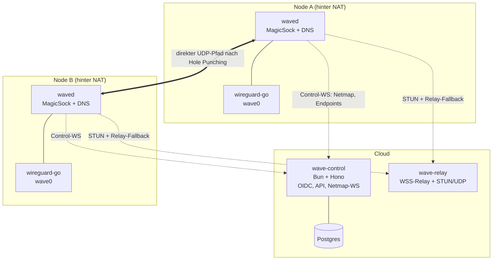
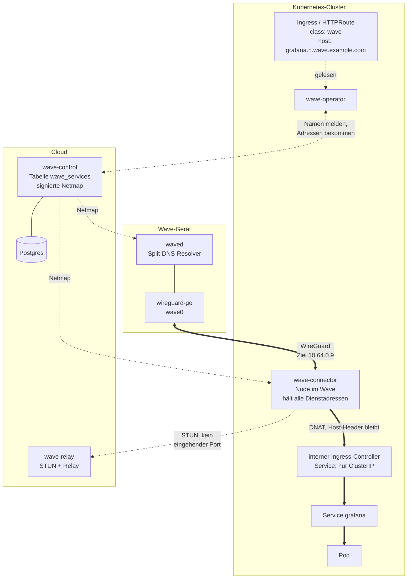
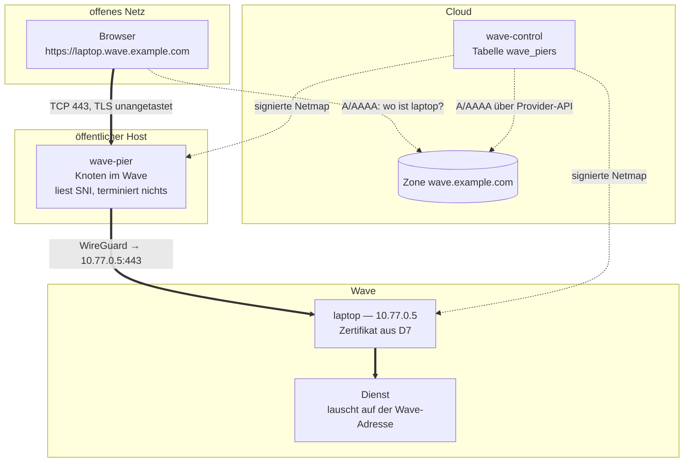
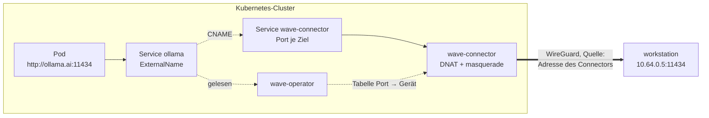
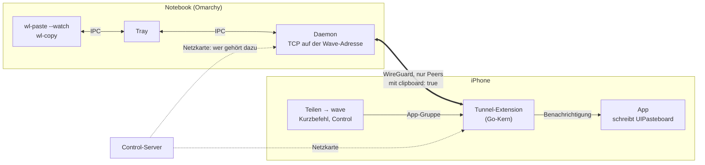

# wave-mesh — Plan für ein selbst gehostetes Mesh-VPN

Stand: 2026-09-17 · Status: Entwurf zur Abstimmung

## 1. Ziel

Ein selbst hostbares Mesh-VPN auf Basis von WireGuard:

- **Control-Server** (Bun): Login per OAuth2/OIDC (Google, Facebook, Instagram, LinkedIn),
  verwaltet Nodes, IP-Vergabe, Hostnamen, Public Keys, ACLs, DNS.
- **Koordination/NAT-Traversal**: Peers verbinden sich direkt, auch wenn beide hinter NAT
  ohne offenen Port sitzen; Fallback über einen Relay-Server.
- **Client** (Bun): meldet sich an, bekommt die Netzkarte (IPs, Hostnamen, Public Keys)
  und konfiguriert WireGuard daraus.
- **DNS**: Namen aus der Netmap unter einer eigenen, vom Nutzer angegebenen Public Domain.
- **Zertifikate**: Let's Encrypt per DNS-01 auf Node- und Dienstnamen — der eigentliche
  Zweck der eigenen Domain.

Begriffe in diesem Dokument: ein **Wave** ist ein Netz, ein **Node**
ein angemeldetes Gerät, die **Netmap** die Liste aller Peers eines Waves.

## 2. Architektur-Überblick



Drei Ebenen, strikt getrennt:

| Ebene | Verantwortung | Kennt private Keys? |
|---|---|---|
| Control | Identität, Autorisierung, Netmap, DNS-Policy | nein |
| Relay/STUN | Endpoint-Reflexion, verschlüsselte Paketweiterleitung | nein |
| Node | WireGuard-Datenebene, lokale Konfiguration | nur den eigenen |

Der Control-Server sieht **nie** WireGuard-Private-Keys und kann den Traffic nicht
entschlüsseln. Der Relay sieht nur WireGuard-Chiffrat.

## 3. Kernentscheidungen

### D1 — Datenebene: userspace-WireGuard hinter einem Bun-„MagicSock"

**Problem:** Für NAT-Hole-Punching muss derselbe UDP-Port für Discovery-Pakete *und*
WireGuard-Traffic benutzt werden. Kernel-WireGuard besitzt seinen Port exklusiv; Bun kann
sich dort nicht dazwischenschalten.

**Entscheidung:** `wireguard-go` (oder `boringtun`) als Sidecar-Binary, das nur auf
`127.0.0.1` lauscht. Der Bun-Daemon besitzt den einzigen öffentlichen UDP-Socket und
multiplext:

```
                      (öffentlich, z.B. :41641)
  Peer-Endpoints  <---->  Bun MagicSock  <---->  wireguard-go (127.0.0.1)
  direkt / Relay           - Disco-Pakete           wave0 (TUN)
                           - Pfadauswahl
                           - Peer <-> Loopback-Port-Mapping
```

- Pro Peer bindet MagicSock einen eigenen Loopback-Socket `L_i`. In wireguard-go steht als
  Endpoint des Peers `127.0.0.1:L_i`.
- Ausgehend: wireguard-go → `L_i` → MagicSock weiß „Peer i" → sendet über den echten
  Socket an den aktuell besten Pfad (direkt oder Relay).
- Eingehend: Paket vom echten Socket → Peer bestimmen → aus `L_i` an wireguard-go
  weiterleiten, damit dieses die Zuordnung behält.
- Unterscheidung Disco vs. WireGuard: WireGuard-Pakete beginnen mit Typ-Byte `0x01`–`0x04`;
  eigene Disco-Pakete bekommen ein 6-Byte-Magic-Prefix (`0x77 0x61 0x76 0x65 0x01 0x00`).

**Konsequenz:** Jedes Paket läuft zweimal durch JS-Userspace. Realistisch sind grob
100–300 Mbit/s pro Node; das ist der bewusst akzeptierte Preis für „alles in Bun".

**Optimierung später (M7+):** Sobald ein direkter Pfad stabil steht, optional auf
Kernel-WireGuard umschalten und den Endpoint direkt setzen (MagicSock behält nur Discovery
und Relay-Fallback). Achtung, offenes Risiko: Kernel-WG und MagicSock können sich den
UDP-Port nicht teilen — dafür braucht es entweder Portwechsel mit neuem Punching oder
`SO_REUSEPORT`-Tricks. Erst nach M6 evaluieren, nicht in v1 einplanen.

**Alternative, verworfen:** reines Kernel-WireGuard mit „Port kurz freigeben und punchen".
Race-anfällig, plattformgebunden, und ein Relay-Fallback ist damit nicht sauber baubar.

### D2 — NAT-Traversal

Ablauf beim Verbindungsaufbau zu einem Peer:

1. **Kandidaten sammeln** (jeder Node, laufend):
   - lokale Interface-Adressen (LAN-Direktverbindung),
   - reflexive Adresse via STUN (RFC 5389 Binding Request) über **denselben** UDP-Port,
   - optional Portmapping via NAT-PMP / PCP / UPnP-IGD (ab M7),
   - Relay-Adresse (immer vorhanden, „Home-Relay").
2. **Austausch** der Kandidatenliste über die Control-WebSocket (Netmap-Update an alle
   berechtigten Peers).
3. **Punching**: beide Seiten senden gleichzeitig Disco-`ping` an alle Kandidaten der
   Gegenseite. Der erste beantwortete Pfad mit der niedrigsten RTT gewinnt.

   ⚠️ **Ein Node darf erst punchen, wenn die Gegenseite wissen kann, wohin sie
   zurückpunchen soll.** Sonst trifft das erste Paket das fremde NAT als
   unaufgeforderten eingehenden Fluss. Linux legt dafür einen Conntrack-Eintrag an,
   der genau das Adresstupel belegt, das die Gegenseite für ihre eigene ausgehende
   Portbeibehaltung braucht — sie wird danach auf einen anderen Port abgebildet als
   den, den STUN gemeldet hat, und keine Seite erreicht die andere mehr. Das Signal
   zum Start ist deshalb die eigene Netmap mit den eigenen Kandidaten: sie erreicht
   beide Seiten im selben Broadcast. Der verbleibende Versatz muss kleiner als die
   RTT zum Peer bleiben, weshalb der Punch-Aufruf vor der WireGuard-Konfiguration
   steht und nicht dahinter.
4. **Start über Relay**: Traffic läuft sofort über den Relay, während geprobed wird — die
   Verbindung ist nie „erst nach dem Punching" benutzbar. Der Relay ist dabei kein
   Sonderfall, sondern ein Pfad wie jeder andere: Pfade werden nach RTT sortiert, und ein
   direkter Pfad gewinnt automatisch, sobald er antwortet. WireGuard merkt davon nichts,
   weil seine Endpoint-Adresse unverändert der lokale MagicSock bleibt.
5. **Erhalten**: Disco-Heartbeat alle 5 s, WireGuard-Keepalive 25 s, Re-Probing bei
   Netzwerkwechsel (Interface-Change, Default-Route-Change).

Bei symmetrischem NAT auf beiden Seiten bleibt es beim Relay — dort gibt es prinzipiell keinen direkten Pfad.

### D3 — Schlüssel- und Identitätsmodell

Pro Node drei Schlüsselpaare:

| Key | Typ | Zweck | Rotation |
|---|---|---|---|
| Machine-Key | Ed25519 | dauerhafte Geräteidentität gegenüber Control/Relay | manuell |
| Node-Key | Curve25519 | WireGuard Public/Private Key | bei `wave up`, Ablauf nach 180 d |
| Disco-Key | Curve25519 | authentisierte Disco-Pakete (NaCl-Box) | pro Sitzung |

Private Keys werden lokal erzeugt (`node:crypto` X25519/Ed25519) und verlassen das Gerät
nie. Der Control-Server signiert die Netmap mit seinem eigenen Ed25519-Key, damit Clients
Peer-Keys nicht blind einem kompromittierten Transport glauben müssen.

### D4 — Authentifizierung (OAuth2/OIDC)

- Bibliothek: **`arctic`** für die Provider-Flows + eigene Session-Tabelle (statt
  All-in-One-Lösung), weil Wave-/Tenant-Zuordnung und Node-Binding ohnehin eigene Logik sind.
- Provider v1:
  - **Google** — vollständiges OIDC, verifizierte E-Mail. Referenzprovider.
  - **LinkedIn** — OIDC (`openid profile email`), verifizierte E-Mail.
  - **Facebook** — OAuth2 mit eingeschränktem OIDC, E-Mail nur wenn freigegeben.
  - **Instagram** — ⚠️ liefert **keine E-Mail-Adresse**; Instagram Basic Display ist
    abgekündigt, Login läuft über „Instagram API with Instagram Login" bzw. Facebook Login.
    → Instagram taugt nicht als primäre Identität. Plan: nur als *verknüpfbarer*
    Zweit-Account zu einem bestehenden Konto, nicht als Erstanmeldung.
- Account-Verknüpfung über **verifizierte** E-Mail; unverifizierte E-Mails werden nie
  automatisch gemerged (klassische Account-Takeover-Lücke).
- CLI-Login-Flow (Node-Binding):

```
wave up
  → Client erzeugt Machine-/Node-Key
  → POST /v1/machine/register {machine_key, node_key, hostname, os}
  ← 200 {auth_url, poll_secret}
  → Browser öffnet auth_url → OIDC-Provider → Callback → Session
  → Bestätigungsseite: "Gerät 'thinkpad' zu Wave 'privat' hinzufügen?"
  → Client pollt POST /v1/machine/poll {poll_secret} bis {status:"authorized", netmap}
```

- Headless/CI: Pre-Auth-Keys (`WAVE_AUTHKEY=wk-...`, einmalig oder wiederverwendbar,
  mit Ablauf und optional „ephemeral"-Flag).

### D5 — Adressraum

- IPv4: `10.64.0.0/10`, **pro Wave ein `/16`**, pro Node ein `/32`. Das ergibt
  64 Waves je Control-Server zu je 65 534 Nodes.
- **Nicht CGNAT (`100.64.0.0/10`), so verlockend es ist.** Wo ein anderes
  Mesh-VPN läuft, *benutzt* es diesen Bereich unter Umständen nicht nur, es
  setzt eine Firewall-Regel,
  die Pakete mit Quelladresse daraus verwirft, sobald sie auf einem anderen
  Interface als dem eigenen ankommen. Ein Wave darin trägt IPv4 dann nur in
  eine Richtung: die Antworten erreichen den Host und werden verworfen, bevor
  sie jemand sieht — IPv6 läuft weiter, weil die ULAs sich unterscheiden.
  Gemessen am 14.09.2026 auf einem Gerät, das beides fährt.
- Der Preis von `10.64.0.0/10` ist die Kollision mit einem Firmen-`10/8`. Der
  Unterschied: die ist sichtbar und über `WAVE_IPV4_CONTAINER` zu umgehen,
  während die CGNAT-Kollision von Software erzwungen wird, die der Nutzer nicht
  konfiguriert hat, und wie ein kaputter Tunnel aussieht.
- IPv6: ULA `fd7a:wave::/48` pro Wave, pro Node ein `/128`.
- `AllowedIPs` je Peer = exakt dessen `/32` + `/128` (später zusätzlich Subnetz-Routen).
- MTU: 1280 als Default (relay- und IPv6-sicher), 1420 optional bei direktem Pfad.

**Ein Block je Wave statt des ganzen Bereichs**, weil ein Gerät in mehreren
Waves gleichzeitig sein kann. Vergäben zwei Waves beide von unten, hätten beide
einen Knoten auf `100.64.0.1`, und der Client bekäme zwei Hostrouten für
dieselbe Adresse. Innerhalb eines Servers ist das damit ausgeschlossen; zwei
unabhängige Server wissen aber nichts voneinander, deshalb `WAVE_IPV4_CONTAINER`
— jeder Server bekommt eine Scheibe des `/10`. Wo das trotzdem kollidiert,
verweigert der Client den zweiten Wave und nennt beide, statt still eine Route
zu überschreiben.

Die Blockgröße lässt sich später nur mit einer Umnummerierung aller Waves außer
dem ersten ändern. Ein `/20` gäbe 1024 Waves zu je 4094 Nodes.

### D6 — DNS und eigene Domain

Die eigene Domain dient primär dazu, **Let's-Encrypt-Zertifikate auf Node-Namen**
ausstellen zu können (Details in D7). Daraus folgen zwei harte Konsequenzen:

- Der DNS-Suffix eines Waves ist eine **öffentlich registrierte Domain**, die dem Nutzer
  gehört (z.B. `wave.example.com`). Der Default-Suffix `*.wave.internal` bleibt nur für
  Waves ohne Zertifikatsbedarf — dafür kann es prinzipiell keine öffentlichen Zertifikate geben.
- Der Control-Server braucht **Schreibrechte auf die öffentliche Zone**, um die
  DNS-01-Challenge (`_acme-challenge.<name>` TXT) zu setzen. Nicht der Node — der Node
  bekäme sonst Kontrolle über die gesamte Domain.

**Gewählt wird der Suffix beim Anlegen des Waves.** Die Anmeldung legte früher
ungefragt einen an und vergab `<name>.wave.internal` dazu; das war bequem, hat
aber dem Server eine Entscheidung überlassen, die er nicht treffen kann — unter
dem Suffix hängt jeder Gerätename, und welche Domain jemandem gehört, weiß nur
er selbst. Ein erster Login landet deshalb auf einem Formular, und der Wave
entsteht erst mit dessen Absenden. Eingegeben wird der **vollständige** Suffix
(`wave.example.com`, nicht eine Basis, unter die der Wave-Name käme), vorbelegt
mit `<name>.wave.internal` — dieselbe Bedeutung, die `admin.ts set-domain` schon
immer hatte. Der Umzug auf eine echte Domain bleibt jederzeit möglich; er zählt
`netmap_version` hoch, weil er jedes Gerät im Wave umbenennt.

`.internal` ist für den Platzhalter das richtige Pseudo-TLD: es kann nie
delegiert werden, ein Wave darin kollidiert also nie mit einer echten Zone —
und ein Zertifikat gibt es dafür ebenso wenig je.

**Namensraum:**

- Node-Namen: `laptop.wave.example.com` (aus der Netmap, lokal beantwortet).
- Alias-Namen: `grafana.wave.example.com` → Node X. Nötig, damit ein Dienst ein eigenes
  Zertifikat auf einen sprechenden Namen bekommt und nicht auf den Gerätenamen.

**Drei Betriebsmodi für die Zone**, der Nutzer wählt einen pro Domain:

| Modus | Wie | Aufwand für den Nutzer | Bewertung |
|---|---|---|---|
| **Provider-API** | Scoped API-Token für Cloudflare / Route53 / deSEC / Hetzner; Control schreibt TXT und optional A/AAAA | Token anlegen, einfügen | **v1-Default**, Cloudflare zuerst, Provider-Interface pluggable |
| **CNAME-Delegation** (acme-dns-Muster) | Nutzer legt einmalig pro Name `_acme-challenge.<name> CNAME <token>.acme.wave.example` an; Control beantwortet die TXT in der eigenen Zone | ein CNAME pro Name | v1-Fallback für „keine Credentials rausgeben" |
| **NS-Delegation** | Nutzer delegiert `wave.example.com` per NS an unseren autoritativen Nameserver | einmalig zwei NS-Records | eleganteste Variante, aber wir müssen autoritatives DNS betreiben → M9 |
| **Manuell** | Der Server nennt den TXT-Record und wartet, bis er in der Zone steht — geprüft an den autoritativen Nameservern der Zone | ein Record je Zertifikat, von Hand | **der Ausweg aus der Provider-Frage**: funktioniert bei jedem Hoster, ohne Zugangsdaten. Preis: auch die Erneuerung braucht wieder einen Menschen |

**Domain-Verifikation:** In den Modi Provider-API und NS-Delegation ist der Besitz implizit
bewiesen (wer schreiben kann, besitzt die Zone). Im manuellen Modus ebenso, nur je Zertifikat
statt einmal: den Record zu erzeugen *ist* der Nachweis. Nur im CNAME-Modus bleibt die
TXT-Verifikation nötig.

**Warum es den manuellen Modus geben muss:** Es gibt hunderte DNS-Hoster, und jeder einzelne
implementierte Provider deckt genau einen davon ab. Ohne einen Weg ohne Zugangsdaten hinge
jedes Zertifikat daran, dass jemand vorher den passenden Provider gebaut hat — und für den
eigenen Hoster ist das immer genau dann nicht der Fall, wenn man ihn braucht. Der manuelle
Modus ist deshalb kein Notbehelf, sondern die Zusicherung, dass die Funktion überall
benutzbar ist; die Provider sind die Bequemlichkeit obendrauf. Was er nicht kann, ist die
unbeaufsichtigte Erneuerung: dafür braucht es einen Provider, und später die CNAME- oder
NS-Delegation, die beide einmalig eingerichtet werden und dann für immer tragen.

**Öffentliche A/AAAA-Records (opt-in, empfohlen an):** Für DNS-01 sind sie **nicht** nötig —
Let's Encrypt prüft ausschließlich den TXT-Record, nie die Adresse. Sie lösen aber ein
reales Betriebsproblem: Browser und OS mit **DNS-over-HTTPS umgehen den lokalen Resolver**,
und der Node-Name lässt sich dann nicht auflösen, obwohl das Zertifikat gültig ist. Wer die
Records veröffentlicht, gibt dafür die Existenz und die Wave-Adresse seiner Nodes preis.

**Lokaler Resolver:** lauscht auf der **eigenen Wave-Adresse** des Nodes, nicht auf einer
festen wie `100.100.100.100` — die ist auf manchem Gerät schon von einem anderen VPN belegt, und
die eigene Adresse existiert ohnehin.

Systemintegration strikt als **Split-DNS**: Linux über `resolvectl dns <iface> <addr>` und
`resolvectl domain <iface> ~<zone>` — das `~` macht die Domain *routing-only*, es wandern
also nur Namen dieser Zone zu uns und alles andere bleibt beim gewohnten Resolver. macOS
über `/etc/resolver/<domain>`, was von Natur aus dasselbe tut.

⚠️ Ohne `systemd-resolved` gibt es unter Linux keinen Weg, einzelne Domains umzuleiten.
Der Client **verweigert** dann die DNS-Konfiguration, statt `/etc/resolv.conf` zu
überschreiben: das würde jede Namensauflösung des Systems umlenken, nicht nur die des
Waves.

**Split-DNS-Routes:** „Alles unter `corp.example.com` an Nameserver `100.64.0.9`" — für
interne DNS-Server, die selbst Nodes im Wave sind.

### D7 — Zertifikate (ACME / Let's Encrypt)

**Zwangsbedingung:** HTTP-01 und TLS-ALPN-01 scheiden aus — sie brauchen öffentliche
Erreichbarkeit auf Port 80/443, die ein Node hinter CGNAT nicht hat. Es bleibt **DNS-01**.

**Ablauf (Control ist ACME-Client, der private Key bleibt auf dem Node):**

```
Node                                   Control                       Let's Encrypt
 |-- Key erzeugen (ECDSA P-256) -------|                                   |
 |-- CSR bauen (@peculiar/x509) -------|                                   |
 |-- POST /v1/cert/order {csr,names} ->| Autorisierung prüfen:             |
 |                                     |  gehoert `name` diesem Node?      |
 |                                     |-- newOrder ---------------------->|
 |                                     |<- dns-01 challenge ---------------|
 |                                     |-- TXT _acme-challenge.<name> ---->| (Provider-API)
 |                                     |-- challenge ready --------------->|
 |                                     |<- valid --------------------------|
 |                                     |-- finalize(CSR) ----------------->|
 |                                     |<- Zertifikatskette ---------------|
 |<- GET /v1/cert/order/:id {chain} ---|  TXT wieder aufraeumen            |
 |  key.pem + fullchain.pem ablegen    |                                   |
```

Entscheidend: Der Node erzeugt Schlüssel und CSR selbst, der Control-Server sieht nur den
CSR und die fertige (öffentliche) Kette. **Kein privater Schlüssel verlässt je einen Node**,
und kein Node bekommt je DNS-Credentials.

**Autorisierung:** Der Control-Server stellt nur Zertifikate für Namen aus, die in der
Netmap diesem Node gehören (eigener Node-Name oder ein ihm zugewiesener Alias). Damit kann
kein kompromittierter Node ein Zertifikat für den Namen eines anderen bekommen.

**Ausstellung on demand, nicht automatisch für alle Nodes** (`wave cert <name>`). Gründe:
Rate Limits und Certificate Transparency (siehe unten). Nach der ersten Ausstellung
erneuert der Daemon selbstständig.

**Erneuerung:** ARI (ACME Renewal Information) abfragen und im vorgeschlagenen Fenster
erneuern; Fallback auf „bei 2/3 der Laufzeit", also ~Tag 60 von 90. Nach erfolgreicher
Erneuerung optionaler Reload-Hook (`--hook 'systemctl reload caddy'`).

**Per-Node-Zertifikate vs. Wildcard:**

| | Per-Node-Zertifikat *(Empfehlung)* | Wildcard `*.wave.example.com` |
|---|---|---|
| Schlüsselkompromittierung | betrifft nur diesen Namen | betrifft **alle** Nodes |
| Rate Limits | pro registrierter Domain begrenzt, Planung nötig | unkritisch, ein Zertifikat |
| CT-Logs | jeder Node-Name wird dauerhaft öffentlich | nur die Domain |
| Verteilung | nichts zu verteilen | privater Schlüssel muss an alle Nodes → sicherheitlich schlecht |

Empfehlung: **per Node**. Wildcard nur als bewusst gewählte Option für
Waves, die CT-Leakage unbedingt vermeiden wollen und der Schlüsselverteilung zustimmen.

**Umgesetzt als Freigabe je Gerät** (`nodes.wildcard_allowed`, gesetzt mit
`admin.ts allow-wildcard <wave> <gerät>`): Ein Wildcard ist kein Name, der einem Gerät
gehört, also kann die Autorisierung ihn auch nicht nach dieser Regel prüfen — es braucht
jemanden, der es über dieses eine Gerät sagt. Wer das Zertifikat hält, kann jeder Name im
Wave sein; deshalb ist die Freigabe ausdrücklich, sichtbar in `admin.ts devices` und
zurücknehmbar. Mit ihr kommt der Name der Zone selbst (`wave.example.com`) dazu, den der
Wildcard nicht abdeckt und den dieselbe Maschine ohnehin bedient. Der eigentliche Gewinnfall
ist **eine** Maschine mit mehreren Diensten — dann wird kein Schlüssel verteilt, und die
Gerätenamen bleiben aus den CT-Logs heraus.

**Certificate Transparency ist ein echtes Leck:** jeder ausgestellte Node-Name landet
dauerhaft in öffentlichen CT-Logs (crt.sh). Wer `laptop-von-robin.wave.example.com`
ausstellt, veröffentlicht diese Information unwiderruflich. Gegenmaßnahme: unauffällige
oder zufällige Namen, oder Wildcard.

**Hardening der Zone:** CAA-Record setzen, der nur Let's Encrypt, nur `dns-01` und nur
unseren ACME-Account erlaubt:
`wave.example.com. CAA 0 issue "letsencrypt.org; validationmethods=dns-01; accounturi=<account_url>"`

**Umsetzung:** ACME-Client serverseitig einmal, nicht pro Node. Bibliothek `acme-client`
im Spike auf Bun-Kompatibilität prüfen; falls sie zickt oder ARI fehlt, eigene
Implementierung (~500 LOC: JWS/ES256, Nonce, newAccount, newOrder, dns-01, finalize,
poll, download). CSR-Erzeugung auf dem Node mit `@peculiar/x509` über WebCrypto.
In Dev/CI **immer gegen das LE-Staging-Verzeichnis** (bzw. Pebble) arbeiten.

### D8 — Persistenz & Stack

| Baustein | Wahl | Begründung |
|---|---|---|
| Runtime | Bun 1.4+ | Vorgabe |
| HTTP/WS | Hono | schlank, sauberes WS-Handling auf Bun, gutes Testing |
| DB | Postgres (prod) / SQLite via `bun:sqlite` (dev, Single-Node-Selfhost) | |
| ORM | Drizzle | typsicher, Migrations, beide Dialekte |
| Validierung | Zod, geteilt in `packages/proto` | ein Schema für Server und Client |
| Krypto | `node:crypto` (X25519/Ed25519) + `@noble/ciphers` für Disco-Box | keine nativen Builds |
| X.509/CSR | `@peculiar/x509` auf dem Node | reines JS über WebCrypto, kein OpenSSL nötig |
| Client-State | JSON-State-File unter `/var/lib/wave/` (0600) | |

### D9 — Mehrere Benutzer je Wave

**Problem:** Ein Wave ist ein Netz mehrerer Menschen, aber es gab keinen Weg,
einen zweiten hineinzubekommen: `wave_members` wurde nur mit der `owner`-Zeile
beschrieben, die `ensureWaveForUser()` beim ersten Login anlegt.

**Entscheidung:** Mitgliedschaft ist die einzige Eintrittskarte, und sie
entsteht auf zwei Wegen — `admin.ts add-member` für den Operator auf der Shell,
und ein **Einladungslink** für den Alltag. Der Link ist an eine Adresse
gebunden, gilt einmal und läuft nach sieben Tagen ab; gespeichert wird nur der
SHA-256 des Tokens, weshalb er genau einmal angezeigt werden kann.

Sichtbarkeit bleibt **voller Mesh**: alle Geräte aller Mitglieder sehen sich,
`buildNetmap()` fragt den Wave und nicht den Benutzer. Damit ist offene Frage 5
beantwortet — ACLs bleiben M7 und sind dann eine Filterung dieser Netmap, keine
Änderung am Mitgliedschaftsmodell.

Drei Folgen, die im Code festgeschrieben sind:

- **Eine offene Einladung verhindert den eigenen Wave.** Sonst entscheidet die
  Reihenfolge zweier Klicks, ob der Eingeladene hinterher einen Wave zu viel
  hat.
- **Ein Gerät gehört zu einem Wave; bei mehreren Mitgliedschaften fragt die
  Freigabeseite.** Eine Mitgliedschaft heißt keine Frage — das ist der Weg, den
  die E2E-Skripte gehen.
- **Entziehen entzieht wirklich.** `removeMember()` löscht die Knoten des
  Mitglieds in diesem Wave; eine stehengelassene Node behielte Adresse, signierte
  Netmap und einen Peer-Eintrag auf jedem fremden Interface.

**Offen:** die Übergabe der Eigentümerschaft (ein `owner` kann derzeit nicht
entfernt werden) und der Versand der Einladung per Mail — heute wird der Link
ausgegeben und von Hand verschickt.

### D10 — Mobile Clients: ein Go-Kern, ein TUN, N WireGuard-Devices

**Problem:** Auf iOS und Android läuft vom heutigen Client nichts. `Bun.spawn`
gibt es nicht, also kann wireguard-go kein Sidecar-Prozess sein; `ip`,
`resolvectl` und `route` gibt es nicht, also fällt `LinkBackend` ersatzlos weg;
Bun selbst läuft dort nicht, also auch `Bun.udpSocket` nicht; und die
iOS-Tunnel-Extension ist bei rund 50 MB gedeckelt, was eine JS-Runtime darin
ausschließt. Portabel ist allein der Vertrag — WaveSig (Ed25519 über eine feste
Zeichenkette), Disco (X25519 → SHA-256 → XChaCha20-Poly1305) und signierte
Netmaps über kanonisches JSON.

Dazu kommt eine Einschränkung, die bis in die Architektur reicht: **beide
Plattformen erlauben genau einen Tunnel je App** — einen
`NEPacketTunnelProvider`, einen `VpnService`. Das Modell aus `state.ts`, je
Anmeldung ein Interface `waveN` und ein UDP-Port 4164N, existiert dort nicht.

**Entscheidung:** Ein gemeinsamer Kern in Go, über `gomobile bind` als
`.xcframework` und `.aar` gebunden, die Oberfläche nativ. Go, weil wireguard-go
ohnehin die Datenebene ist und dort als Bibliothek statt als Prozess läuft, weil
der Kern unter Linux mit den vorhandenen Netns-Skripten testbar bleibt, und weil
das Speicherbudget der iOS-Extension mit wireguard-go erprobtes Terrain ist.

Die Waves werden in **ein** TUN multiplext, und zwar mit erhaltenen Schlüsseln:
je Wave ein eigenes `device.Device` über einem virtuellen TUN, davor ein
Demultiplexer, der ausgehende Pakete nach Zielpräfix dem richtigen Wave
zuordnet. Die Routing-Tabelle, die er dafür braucht, ist genau die, deren
Disjunktheit `overlap.ts` bereits garantiert — es kommt keine Bedingung hinzu,
es wird eine bestehende benutzt.

Die Alternative wäre ein einziges Device mit einem geteilten Node-Key für alle
Waves: einfacher und sparsamer, gibt aber die Schlüsseltrennung je Anmeldung
auf. Derselbe öffentliche WireGuard-Schlüssel stünde dann in jeder Netmap, und
zwei Waves mit einem gemeinsamen Mitglied könnten das Gerät wiedererkennen. Sie
bleibt die Rückfallebene, falls N Devices das Extension-Budget sprengen.

Je Schicht:

| Schicht | Auf dem Telefon |
|---|---|
| Control | **N-fach, unverändert** — N Sockets, N Machine-Keys, N gepinnte Signaturschlüssel |
| MagicSock | **eine**, ein öffentlicher UDP-Port; Peers unter `(waveId, nodeKey)` |
| WireGuard | **N Devices** über einem TUN, Node-Key je Anmeldung |
| OS-Settings | **eines** — Adressen und Routen als Vereinigung, MTU als Minimum |
| DNS | **ein Resolver** mit Suffix→Wave-Tabelle, ohne eigenen Socket |

Der eine öffentliche Port ist dabei kein Verlust, sondern eine Vereinfachung: es
gibt nur noch eine Kandidatenliste und eine reflexive Adresse, veröffentlicht an
alle N Server, statt je Wave einmal zu STUNen.

Vier Folgen, die der Kern von Anfang an tragen muss:

- **Der Loopback-Socket je Peer entfällt.** wireguard-go nimmt ein eigenes
  `conn.Bind` entgegen; die MagicSock *ist* dann der Bind, und jedes Device
  bekommt eine Sicht darauf, die nur die Pakete seines Waves liefert.
  `bindLoopback()` existiert nur, weil Bun kein `conn.Bind` anbieten kann.
- **Schlüssel dürfen sich so wenig überschneiden wie Adressen.** Disco-Pakete
  tragen den Absenderschlüssel im Klartext, und auf einem gemeinsamen Socket
  schlägt `peerForDisco()` über alle Waves hinweg nach. Ein bösartiger
  Control-Server könnte sonst einen Peer mit dem Disco-Key eines fremden Waves
  ankündigen und sich in dessen Nachschlagen hängen. Also: zwei Waves mit
  demselben Node- oder Disco-Key → der zweite wird abgelehnt, und beide werden
  genannt, wie bei `overlap.ts`.
- **Erst die Vereinigung, dann anwenden.** `setTunnelNetworkSettings` wird
  atomar angewandt und kennt kein Teilversagen; damit wird die Overlap-Prüfung
  von der Vorsichtsmaßnahme zur Vorbedingung. Und weil erneutes Anwenden den
  Tunnel kurz unterbricht, darf eine Netmap-Änderung nur anwenden, wenn sich die
  Vereinigung wirklich geändert hat — den Diff rechnet `reconcile.ts` bereits
  aus, er muss nur über alle Waves laufen statt über einen.
- **Der Netzwechsel ist der Normalfall, nicht die Ausnahme.** WLAN→LTE muss
  sofort Rebind, Neusammeln der Kandidaten und `publishEndpoints` auslösen
  (`NWPathMonitor`, `ConnectivityManager.NetworkCallback`); heute greift der
  Rebind-Timer erst, wenn Peers unerreichbar sind.

**Offen:** ob der Go-Kern später auch die Bun-Engine auf dem Desktop ablöst —
dort sind getrennte Interfaces beim Debuggen echter Komfort, das ist also nicht
selbstverständlich. Android setzt DNS geräteweit
(`VpnService.Builder.addDnsServer()` kennt kein `matchDomains` wie iOS); die
Invariante „nie den System-Resolver übernehmen" ist dort nicht haltbar, und aus
dem heute optionalen Weiterreichen an die vorherigen Upstreams wird eine
Pflicht. Und iOS verlangt das `packet-tunnel-provider`-Entitlement, also einen
bezahlten Developer-Account auch fürs eigene Gerät.

### D11 — Kubernetes-Ingresses im Wave: Dienste sind Adressen, keine Knoten

**Problem:** Ein Ingress oder eine `HTTPRoute` soll aus dem Wave erreichbar sein
und sonst nirgends. Der naheliegende Griff — je Route ein Node — geht nicht auf:
`Peer` verlangt `node_key` und `disco_key`, und `desiredPeers()` macht aus jedem
Eintrag einen WireGuard-Peer. Ein Ingress hat keine Schlüssel, und zwanzig davon
wären zwanzig Tunnel mit je eigener MagicSock, eigenem UDP-Port und eigenem
wireguard-go im selben Pod.

**Entscheidung:** Je Cluster ein **Connector**, der sich als ganz gewöhnlicher
Node anmeldet — eine Identität, ein Tunnel —, und je exponiertem Ingress eine
eigene Adresse aus dem `/16` des Waves samt Namen unter dessen Suffix. Die
Adressen stehen in den `allowed_ips` des Connectors, die Namen in einer neuen
Liste `Netmap.services` (`name`, `dns_name`, `ipv4`, `ipv6`, `via_node_id`).



Gestrichelt ist die Steuerebene, dick der Verkehr. Zwei Wege sind darin zu
lesen:

**Wie ein Name entsteht.** Der Operator sieht einen Ingress der Klasse `wave`,
liest dessen `host` und meldet ihn der Control-API; die vergibt Namen und
Adresse aus dem `/16` des Waves und schreibt beides nach `wave_services`. Von da
an trägt jede Netmap den Dienst zweimal: als Eintrag in `services` — daraus
macht `syncDns()` einen Record — und als zusätzliche `allowed_ips` am
Connector-Peer, woraus `desiredRoutes()` auf **jedem** Gerät eine Route in den
Tunnel macht. Der Connector selbst erfährt aus seiner eigenen Netmap, welche
Adressen er sich aufs Interface zu legen hat.

**Wie eine Anfrage läuft.** `curl https://grafana.rl.wave.example.com` fragt den
lokalen Resolver, der die Antwort aus der Netmap kennt — die Frage verlässt das
Gerät nicht. Die Adresse ist über `wave0` geroutet, das Paket geht also
verschlüsselt an den Connector, wie zu jedem anderen Peer. Dort setzt eine
nftables-Regel das Ziel auf die ClusterIP des internen Controllers um und lässt
**Host-Header und SNI unangetastet** — genau deshalb muss der Wave-Name der
Ingress-Host sein: der Controller wählt damit die richtige Regel und das
richtige Zertifikat, ohne dass irgendwo TLS terminiert wird.

Was in dem Bild fehlt, ist Absicht: **von außen führt keine Kante hinein.** Der
Connector braucht keinen eingehenden Port — STUN und der Relay-Fallback tragen
ihn aus dem Cluster heraus —, und der interne Ingress-Controller hat nur eine
ClusterIP. Erreichbar ist der Dienst damit über genau einen Weg, und der führt
durch den Wave.

Der Client lernt dafür fast nichts dazu, weil die Haken schon da sind:
`Peer.allowedIps` ist ausdrücklich „its own addresses plus any routes" und wird
heute nur hart mit `/32` + `/128` gefüllt; `desiredRoutes()` klopft die
`allowedIps` aller Peers flach, und `syncAddresses()`/`syncRoutes()` konvergieren
ohnehin gegen den Ist-Zustand. Damit routet jeder Peer die Dienstadressen in den
Tunnel und der Connector legt sie sich aufs Interface, ohne dass eine dieser
Funktionen sich ändert. Zu tun ist es serverseitig — `buildNetmap()` und eine
Tabelle — und in `syncDns()`, das die Dienste mit in seine `records` nimmt;
PTR und die Rückwärtszonen fallen dann von selbst richtig, weil die Adressen im
`/16` des Waves liegen.

**Der Wave-Name *ist* der Ingress-Host.** Ein Ingress wird über den Host-Header
ausgewählt: leitet der Connector stumpf auf die ClusterIP des Controllers weiter,
während der Ingress auf `grafana.intern.example.com` lautet, kommt ein 404
zurück. Also trägt der Ingress `host: grafana.rl.wave.example.com`, und der
Operator liest ihn genau dort ab. Dann ist der Connector ein reiner
L4-Weiterleiter — im Grenzfall eine nftables-Regel, denn *alle* Dienstadressen
zeigen auf dasselbe Backend und der Host-Header entscheidet drinnen. TLS bleibt
dabei unangetastet: die SNI kommt richtig beim Controller an. Ein L7-Proxy, der
Host-Header umschreibt, müsste TLS terminieren und wäre ein zweiter Ort, an dem
Routing-Wissen liegt.

Sechs Dinge, die daran hängen:

- **Namen und Adressen liegen in *einem* Namensraum mit den Knoten.** Ein Name
  im Wave soll eine Sache bezeichnen, also darf `grafana` nicht zugleich ein
  Gerät und ein Ingress sein. Über zwei Tabellen hinweg gibt es keinen
  Unique-Index, deshalb läuft die Vergabe unter einem Row-Lock auf `waves` —
  dort sitzt mit `netmap_version` ohnehin schon der Serialisierungspunkt.
  `allocateIpv4()` selbst genügt unverändert: die Dienstadressen kommen mit in
  sein `taken`-Argument.
- **Die Cluster-CIDR bleibt draußen.** Ein klassischer Subnetz-Router würde
  `10.43.0.0/16` annoncieren, und zwei Cluster mit derselben Service-CIDR wären
  damit unvereinbar. Hier sieht der Wave nur Adressen aus seinem eigenen Block —
  beliebig viele Cluster, und `overlap.ts` bekommt nichts Neues zu tun.
- **„Nur aus dem Wave" kommt aus dem Cluster, nicht von wave.** Nötig ist ein
  eigener, interner Ingress-Controller mit ClusterIP-Service (nie LoadBalancer)
  und eine NetworkPolicy, die nur den Connector-Pod zu ihm lässt. wave macht
  einen Dienst erreichbar; unerreichbar machen kann es ihn nicht. Hängt derselbe
  Ingress auch am öffentlichen Controller, ist er öffentlich, und der Wave-Name
  ist bloß ein zweiter Weg hinein.
- **Der Operator ist kein zweiter Wahrheitsort.** Er watcht `Ingress` mit
  `ingressClassName: wave` und `HTTPRoute` an einem `Gateway` derselben Klasse
  und gleicht gegen die Control-API ab; die Zuordnung Name→Adresse gehört dem
  Server. Fällt der Operator aus, tragen die Routen weiter, weil die Netmap
  signiert und zwischengespeichert ist.
- **Dienste ändern sich häufiger als Geräte.** Ein vollständiger Netmap-Push bei
  jedem `kubectl apply` wird in einem lebhaften Cluster geschwätzig — entweder
  eine `service`-Operation in `PeerChange` dazu, oder der Operator entprellt.
- **Der Pod braucht `NET_ADMIN` und `/dev/net/tun`, aber keinen eingehenden
  Port.** STUN und der Relay-Fallback tragen das aus dem Cluster heraus; genau
  dafür gibt es sie. Auf der `wave0`-Seite gehört MSS-Clamping dazu, sonst ist
  die 1280er MTU ein Fehlerbild, das erst bei großen Antworten auffällt.

**Beide Voraussetzungen stehen inzwischen:** Pre-Auth-Keys (`admin.ts auth-key`,
`wave login --auth-key`) und die Zertifikate aus M6. Dort zahlt sich der Aufbau aus:
der Dienstname liegt unter der eigenen öffentlichen Domain des Waves, also gibt
DNS-01 ein echtes Zertifikat für einen Dienst, den es von außen nicht gibt. Das
ist der beste denkbare Beleg für das M6-Ziel.

**Der kleinste erste Schritt** wäre dieselbe `services`-Liste *ohne* eigene
Adressen: alle Namen zeigen auf die eine Adresse des Connectors, der per
Host-Header verteilt. Das kostet keine Adressvergabe und keine Änderung an den
`allowed_ips`, nur DNS-Records. Eigene Adressen sind dann ein Feld mehr — und
sie sind das, was Dienst-ACLs, Nicht-HTTP-Dienste (gRPC, Postgres, SSH) und ein
Zertifikat je Dienst überhaupt erst möglich macht.

**Offen:** Durch das DNAT sieht die Anwendung die Pod-IP des Connectors als
Quelle, nicht die Wave-Adresse des Aufrufers. Zählt die Herkunft im Log oder in
einer späteren ACL, braucht es PROXY-Protokoll v2 zum Controller (nginx und
Traefik können es) — dann ist der Connector aber kein reines DNAT mehr. Ebenso
offen, wie das Zertifikat in den Cluster kommt: cert-manager mit DNS-01 beim
selben Provider kostet keinen neuen Code, der integrierte Weg wäre ein Operator,
der `wave cert` fährt und das Secret schreibt. Und bis ACLs stehen (M7), sieht
jedes Gerät jedes Mitglieds jeden Dienst, weil `buildNetmap()` den Wave fragt
und nicht den Benutzer.

### D12 — Pier: ein Name aus dem Wave im offenen Netz

**Problem:** Ein Dienst auf einem Knoten soll aus dem *offenen Netz* erreichbar
sein — ohne eingehenden Port, ohne feste IP, ohne Portfreigabe im Router, und
ohne dass irgendjemand auf dem Weg mitlesen kann. Das ist das Gegenstück zu D11
und dessen genaues Gegenteil: dort war „nur aus dem Wave" das Ziel, hier ist es
„auch von außen". Der naheliegende Griff — Portforwarding auf den Knoten — ist
genau das, was dieser Aufbau abschaffen wollte, und an CGNAT scheitert er
ohnehin.

Der übliche Weg dafür ist eine Ingress-Flotte des Anbieters: öffentlicher
Verkehr landet auf dessen Servern, wird **anhand der SNI** weitergereicht und
läuft über ein Relay zum Knoten, der TLS selbst terminiert. Entscheidend daran ist, was *nicht*
passiert: die Ingress-Server terminieren kein TLS und können nichts lesen.

**Entscheidung:** Dasselbe, aber mit dem Datenpfad, den wir schon haben. Ein
**Pier-Knoten** auf einem öffentlich erreichbaren Host meldet sich wie jeder
andere Knoten im Wave an (Pre-Auth-Key, eigene Netmap — genau wie der Connector
in D11), lauscht auf 443, liest die SNI aus dem ClientHello, schlägt den Namen
in seiner **signierten Netmap** nach und spleißt die TCP-Verbindung über
WireGuard an die Wave-Adresse des Knotens. TLS bleibt dabei unangetastet: die
Sitzung endet auf dem Knoten, mit dessen eigenem Zertifikat aus D7 — das er für
genau diesen Namen ohnehin schon hat.



Gestrichelt ist die Steuerebene, dick der Verkehr. Die eine Kante, die alles
trägt, ist die mittlere: **von `F` nach `N` geht ein gewöhnlicher
WireGuard-Tunnel**, mit Hole Punching, Relay-Fallback und Pfadwahl wie zwischen
zwei beliebigen Geräten. Deshalb braucht der Pier kein eigenes
Multiplex-Protokoll, keine Stream-Verwaltung und keinen zweiten Vertrauenspfad:
er löst nichts, was der Wave nicht schon löst.

Was daran festliegt:

- **Der Pier-Knoten ist ein Knoten, keine neue Infrastruktur.** Er bekommt
  eine signierte Netmap, und die sagt bereits, welcher Name welche Adresse hat.
  Eine geteilte Ingress-Flotte braucht an dieser Stelle mehr — signierte
  Tickets, eine Multiplexschicht im Relay —, weil sie *außerhalb* jedes Netzes
  steht. Wer seinen Pier selbst betreibt, hat dieses Problem
  nicht.
- **Terminiert wird nichts.** Der Pier liest die SNI und schiebt danach nur
  noch Bytes. Das ist keine Sparsamkeit, sondern die ganze Eigenschaft: er hält
  keinen privaten Schlüssel, sieht keinen Klartext, und ein kompromittierter
  Pier gibt keine Sitzung preis. Möglich ist das **nur wegen D7** — ohne ein
  öffentlich gültiges Zertifikat auf dem Knoten müsste die Kante terminieren,
  und dann läge dort alles offen.
- **Der öffentliche A/AAAA-Record ist der offene Punkt aus M5, endlich mit
  einem Zweck.** Der Control-Server schreibt `laptop.wave.example.com` auf die
  öffentliche Adresse des Piers — über die Provider-API oder im manuellen
  Modus als Aufforderung, genau wie bei der dns-01-Challenge (D6). Und er zeigt
  dann eben **nicht** auf die Wave-Adresse: die beiden Opt-ins aus M5 schließen
  sich je Name aus, denn ein Name kann nur eines von beidem bedeuten.
- **Öffentlich wird nichts von selbst, und nicht von jedem.** Zwei Schlösser,
  dieselbe Teilung wie beim Wildcard in D7: der Betreiber erlaubt den Pier für
  ein Gerät (`admin.ts allow-pier`), und erst dann schaltet dessen Besitzer
  einen Namen und einen Port frei (`wave pier 443`). Vorgabe ist aus. Ein
  Mitglied darf einen Wave nicht im Alleingang ins offene Netz stellen, und ein
  Server darf das nie raten.
- **Der Pier steht im Wave, und das ist der Preis.** Die Kiste mit der
  öffentlichen Adresse ist Mitglied des Mesh; bei vollem Mesh (D9) und ohne ACLs
  (M7) ist ihre Übernahme ein Fuß in der Tür zum ganzen Wave. Genau deshalb
  steht eine geteilte Ingress-Flotte außerhalb. Solange ACLs fehlen, gehört in die
  Dokumentation, dass ein Pier-Knoten wie ein Bastion-Host zu behandeln ist —
  eigene Maschine, sonst nichts darauf.
- **Ein Dienst aus D11 geht mit hinaus, ohne dass irgendetwas dazukommt.** Seine
  Adresse steht in den `allowedIps` des Connectors, der Pier routet sie also
  wie jede andere. Ein Cluster-Ingress wird damit durch *einen* Record
  öffentlich — und behält dabei das Zertifikat, das er schon hat.
- **Nur TLS, nur TCP.** Klartext-HTTP auf 80 kann der Pier höchstens auf HTTPS
  umleiten; das darf er, weil dabei nichts Geheimes durch ihn läuft.
  QUIC und damit HTTP/3 haben ihr ClientHello *in* UDP und bräuchten einen
  QUIC-fähigen Parser — deshalb wird kein HTTPS-RR mit `h3` veröffentlicht, und
  Clients fallen auf TCP zurück. **Encrypted Client Hello nähme die SNI ganz
  weg** und mit ihr den Punkt, an dem hier geroutet wird; solange wir kein
  HTTPS-RR mit einer ECH-Konfiguration publizieren, verschlüsselt kein Client
  seine SNI. Das ist dieselbe Ecke, in der jeder SNI-Router sitzt, und es ist eine
  Wette auf ein Protokoll, das wir nicht kontrollieren.
- **Der Pier muss die Kante besitzen, an der 443 liegt.** Im heutigen Deployment
  gehört die Caddy. Entweder bekommt der Pier eine eigene Maschine
  beziehungsweise Adresse, oder er steht *vor* Caddy und reicht alles durch, was
  keiner seiner Namen ist — ein SNI-Router ist dafür das richtige Werkzeug, aber
  er verschiebt die Kante eines Hosts, auf dem noch jemand anderes deployt (siehe
  CLAUDE.md, „Die Maschine gehört nicht uns allein"). Ein zweiter Port taugt zum
  Beweis und nicht für eine URL, die jemand tippen soll.
- **`Netmap.piers` ist eine Liste wie `services`** — und dieselbe Regel gilt:
  `looseObject`, kein `.default()`. Sonst meldet ein Client einer Generation die
  einwandfreie Netmap der anderen als gefälscht, und das sieht wie ein Angriff
  aus. Beim Hinzufügen von `services` ist genau das zweimal passiert.
- **Ist der Knoten weg, wird abgewiesen, nicht getröstet.** Eine freundliche
  Fehlerseite verlangte, TLS zu terminieren — also gibt es sie nicht. Die
  Verbindung wird geschlossen, und was los ist, steht in `wave pier status`.

**Der kleinste erste Schritt** ist der Pier-Knoten *ohne* jede Änderung an der
Steuerebene: eine Konfigurationsdatei mit `name → wave-adresse`, ein Listener
auf 443, SNI lesen, spleißen. Das beweist den Weg von außen bis zum Dienst und
braucht weder eine Tabelle noch einen Record-Schreiber. Danach ist alles Weitere
je ein Feld: die Liste in der Netmap, der A-Record aus dem Control-Server, die
beiden Schlösser.

**Die Variante für geteilte Infrastruktur** — ein Pier, der für fremde Waves
trägt und deshalb in keinem stehen darf — ist der Relay: ein zweiter Endpunkt
`/pier` neben dem heutigen Paket-Relay, über den ein Knoten eine ausgehende
Verbindung hält, in der Ströme multiplext werden. Das kostet genau das, was die
Knoten-Variante spart: eine Stream-Schicht mit Flusskontrolle (ein langsamer
Strom darf die anderen nicht blockieren) und ein vom Control-Server signiertes
Ticket `{name, discoKey, exp}`, weil der Relay der Behauptung eines Knotens, ein
Name zu gehören, nicht glauben darf. Damit lernt der Relay auch etwas, das er
heute ausdrücklich nicht weiß: welche öffentlichen Namen es gibt, wie viele
Bytes durch sie fließen und woher die Aufrufer kommen. Das ist eine bewusste
Schwächung seiner Rolle — sie gehört in die Entscheidung, nicht in eine Fußnote.

**Offen:** Die Herkunft des Aufrufers geht verloren — der Dienst sieht die
Wave-Adresse des Piers, nicht die öffentliche IP. PROXY-Protokoll v2 trüge
sie, aber dann ist der Pier kein reiner Spleiß mehr und der Dienst muss es
sprechen; dieselbe offene Frage wie beim Connector in D11. Ebenso offen:
Quoten und Missbrauchsschutz (der Pier ist die einzige Stelle, an der eine
Grenze sitzen kann), und ob es neben HTTPS weitere TLS-Dienste geben soll —
SMTP oder IMAP mit STARTTLS lassen sich nicht nach SNI routen, weil die
Verbindung im Klartext beginnt.

### D13 — Selbstaktualisierung der Clients

**Problem:** Ein Client, der einmal installiert ist, bleibt auf seiner Version
stehen, bis jemand ein neues Archiv holt und `wave install` erneut fährt. Bei
einem Tunnel ist das schlimmer als bei gewöhnlicher Software: eine
Sicherheitslücke im Client ist eine in einem Prozess, der als root
beziehungsweise LocalSystem läuft, und ein Gerät, das niemand mehr anfasst,
bekommt den Fix nie. Heute weiß das Binary nicht einmal, welche Version es ist —
`scripts/build-clients.sh` bettet keine ein, und es gibt kein `wave version`.

**Entscheidung:** Der **Daemon** aktualisiert sich selbst, aus einem **Kanal**
der GitHub-Releases, und nur mit einem **signierten** Release. **Welche Kanäle
es gibt, legt der Control-Server fest** (`WAVE_UPDATE_CHANNELS`, einer oder
mehrere). Die Bytes kommen
über den **Control-Server**, der sie von GitHub durchreicht — vertraut wird
dabei allein dem Release-Schlüssel, nie dem Weg.

**Transport und Vertrauen sind zwei Fragen.** Worauf sich das Gerät verlässt,
ist die Ed25519-Signatur mit einem ins Binary kompilierten Schlüssel; woher
die Bytes kamen, spielt dafür keine Rolle, genauso wenig wie bei einem CDN. Der
Control-Server ist deshalb eine **Quelle, keine Autorität**: er kann nichts
einschleusen, nur Echtes weiterreichen. Die rote Linie liegt woanders: **der
Control-Server signiert nie.** Täte er es, könnte jeder Betreiber eines Waves,
in dem ein Gerät ist, darauf Code als root ausführen.

Warum überhaupt über ihn und nicht direkt von GitHub:

- **Der aktuelle ReleaseFeed verwendet einen Token.** Für private Releases
  braucht GitHub ihn auch zum Lesen. Er gehört nicht auf ein Gerät: dort läge
  er auf jeder Maschine, die man je verkauft, verliert oder weitergibt. Der
  Control-Server ist die eine Stelle, an der er liegen kann, genau wie
  `WAVE_DNS_SECRET` und aus demselben Grund. Auch bei einem öffentlichen
  Repository bleibt das vorerst die Implementierung.
- **Den Control-Server erreicht jedes Gerät**, sonst hätte es keinen Tunnel.
  `github.com` erreicht es in einem Firmennetz mit Proxy oder in einem
  abgeschotteten Netz oft nicht.
- **Push statt Poll.** `/v1/control` ist ohnehin eine gehaltene Verbindung; der
  Server sagt „es gibt X", statt dass jedes Gerät alle paar Stunden bei GitHub
  anklopft.
- **Der Betreiber sieht, wer wo steht**, weil dieselbe Verbindung die Version
  des Geräts meldet (siehe unten).

**Das signierte Dokument ist ein Manifest, nicht bloß `SHA256SUMS`.** Der
Release-Job schreibt `manifest.json` — Version, Kanal, je Archiv Name,
Plattform, Größe und SHA-256 — in kanonischem JSON (`packages/crypto`) und
signiert es mit einem **Ed25519-Release-Schlüssel**, dessen Geheimnis nur im
Repository-Secret `WAVE_RELEASE_SIGNING_KEY` liegt. Rotiert wird über das
Binary, nicht über das Manifest: `RELEASE_PUBLIC_KEYS` ist eine Liste, ein
Release mit dem alten Schlüssel bringt ein Binary, das den neuen schon kennt,
und erst danach wechselt das Secret. Ein Schlüssel, den das Manifest selbst
mitbrächte, bewiese nichts. Kanal und Version *müssen* darin stehen: signierte Hashes allein ließen
einen Server einem Gerät auf `stable` ein `develop`-Build unterschieben — echt,
gültig signiert und aus dem falschen Kanal. `SHA256SUMS` bleibt für Menschen
daneben liegen.

**Der Weg eines Updates:**

1. **Der Server löst seine Kanäle auf.** `WAVE_UPDATE_CHANNELS` nennt sie als
   Liste, etwa `stable,insiders`; der **erste Eintrag ist die Vorgabe** für jedes
   Gerät, das selbst keinen wählt. Ungesetzt heißt das `stable`. Er fragt die
   Releases von
   `WAVE_UPDATE_REPO` (Vorgabe `moellenbeck-digital/wave-mesh`) ab, höchstens alle
   zehn Minuten und im Speicher gehalten, holt je konfiguriertem Kanal das neueste
   `manifest.json` samt Signatur und prüft sie. Diese Prüfung ist ein Filter
   gegen Müll, kein Schutz — geschützt wird auf dem Gerät. Ohne
   `WAVE_GITHUB_TOKEN` (siehe unten) bietet er nichts an und sagt das einmal
   beim Start; ein Server, der Updates nicht kann, ist kein kaputter Server.
2. **Er bietet an.** Das Gerät nennt im `hello` Version, Plattform und — falls
   es einen gewählt hat — seinen Wunschkanal. Der Server bestimmt daraus den
   Kanal des Geräts: den Wunsch, wenn er in der Liste steht, sonst die Vorgabe;
   was es geworden ist, sagt er im Status zurück. Ist dort etwas Neueres da,
   schickt der Server
   `{ type: "update", manifest, signature }` — beim Verbinden und immer dann,
   wenn sein Takt ein neues Release findet.
3. **Das Gerät prüft und wartet.** Signatur gegen den eingebauten Schlüssel,
   der Kanal im Manifest ist der, den der Server ihm zugewiesen hat, Version größer als die eigene, nicht als kaputt vermerkt —
   sonst verworfen und einmal geloggt. Danach ein **zufälliger Versatz** von
   bis zu einigen Stunden, derselbe Grund wie beim ARI-Fenster: nicht alle
   zugleich, und hier zusätzlich, weil jeder Download durch *einen*
   Control-Pod läuft.
4. **Es lädt durch den Server.** `GET /v1/update/<version>/<archiv>`, signiert
   mit dem Maschinenschlüssel wie jede andere Knotenroute. Der Server holt das
   Asset über die API (`/repos/…/releases/assets/<id>` mit
   `Accept: application/octet-stream` und dem Token) und reicht den Body als
   Stream durch (`new Response(res.body)`), ohne ihn abzulegen — ein Cache wäre
   ein Volume für Hunderte MB, das niemand braucht, solange der Versatz die
   Last verteilt. Bei privaten Releases taugt die Download-URL der Release-Seite
   dafür nicht: sie nimmt keinen Token an.
5. **Es prüft vor dem Entpacken** den SHA-256 gegen das Manifest, wie heute
   beim Wintun-Zip, und tauscht dann (siehe unten).

Was daran festliegt:

- **Nur der Daemon, nie die CLI oder das Tray.** Er ist der einzige Prozess,
  der ins Installationsverzeichnis schreiben darf. CLI und Tray zeigen „Update
  verfügbar" und können über IPC ein `update` anstoßen — *welche* Version und
  *woher*, entscheidet der Daemon selbst. Sonst könnte jedes Mitglied der
  Socket-Gruppe root ein beliebiges Binary unterschieben.
- **Die Kanäle gehören dem Server, die Wahl darin dem Gerät.** Zur Auswahl
  stehen die, die der Release-Workflow schon unterscheidet — `stable`,
  `insiders`, `develop` —, und jeder nimmt seine eigenen Releases und die stabileren:
  `insiders` nimmt auch ein Stable, `stable` nie ein Insiders. Der Betreiber
  entscheidet mit der Liste, was in seinem Wave überhaupt angeboten wird — ein
  Produktiv-Wave führt nur `stable`, ein Test-Wave `insiders,stable` —, und mit
  dem ersten Eintrag, was ein Gerät ohne eigene Wahl bekommt. Damit ist auch
  beantwortet, ob ein Betreiber einen Kanal empfehlen kann: die Vorgabe *ist*
  die Empfehlung, und mehrere Einträge sind das, was er zur Wahl stellt.
- **Mehrere Waves, mehrere Listen.** Jeder Server weist seinen Kanal für sich
  zu und bietet daraus an; das Gerät nimmt **das höchste gültige Angebot** über
  alle. Welchem Betreiber es glaubt, muss es nie entscheiden — jedes Angebot
  ist ein echtes, signiertes Release aus einem Kanal, den sein Betreiber
  freigegeben hat. Scheitert der Download bei einem, fragt es den nächsten, der
  dieselbe Version anbietet.
- **Das signierte Manifest trägt den Kanal trotzdem.** Der Server wählt zwar
  den Kanal, aber das Gerät prüft, dass das Angebot wirklich aus diesem Kanal
  stammt — sonst könnte ein Server, der nur `stable` führt, einem Gerät ein
  `develop`-Build als Stable ausgeben. Wer `develop` anbieten will, muss es in
  die Liste schreiben, und das steht dann im Status jedes Geräts.
- **Kein Downgrade.** Die neue Version muss größer sein als die eigene, sonst
  spielt ein Server ein altes, verwundbares Release mit gültiger Signatur ein.
  Ein Wechsel von `insiders` auf `stable` wartet, bis Stable aufholt.
- **Kein offener Proxy.** Der Server reicht nur Archive durch, die im zuletzt
  geprüften Manifest stehen, nur aus dem einen konfigurierten Repo und nur an
  angemeldete Knoten. Sonst wäre die Route eine Möglichkeit für jeden, seinen
  Verkehr zu GitHub über fremde Bandbreite zu schicken.
- **Der Token liegt nur auf dem Server, und er kann so wenig wie möglich.**
  Ein Fine-grained Token, eingeschränkt auf dieses eine Repo, mit
  *Contents: read* und sonst nichts; er steht als `WAVE_GITHUB_TOKEN` in
  `secret.env` neben den anderen Geheimnissen. Kein Gerät bekommt ihn, keine
  Antwort trägt ihn, und kein Log schreibt ihn.
- **Die Umleitung auf den Speicher folgt ohne Token.** Die Asset-Route antwortet
  mit 302 auf eine vorsignierte URL bei einem fremden Host. Der Server folgt ihr
  von Hand (`redirect: "manual"`) und schickt dorthin keinen
  `Authorization`-Header — ob `fetch` ihn beim Wechsel des Hosts selbst
  abstreift, soll nicht die Frage sein, an der der Token hängt.
- **Was ein böswilliger Betreiber dann noch kann**, ist ein echtes Release aus
  dem richtigen Kanal früher anzubieten, als das Gerät es sonst bekäme — oder
  gar keines. Das Erste ist harmlos. Gegen das Zweite gibt es, solange das
  Repo privat ist, **keinen Rückfall**: ohne Token kann das Gerät nicht selbst
  bei GitHub nachsehen. Ein Gerät, dessen einziger Wave keine Updates anbietet,
  bleibt also stehen — das ist der bekannte Preis, und `wave status` zeigt die
  eigene Version, damit er auffällt. Wird das Repo öffentlich, ist der direkte
  Weg mit denselben Prüfungen der naheliegende Rückfall.
- **Festhalten kann ein Betreiber eine Flotte nicht**, nur ihren Kanal wählen.
  Eine *Version* zu halten wäre genau das Wort eines Betreibers über ein
  fremdes Gerät. Wer eine Version halten will — oder einem Betreiber nicht
  folgen, der `develop` vorgibt —, schaltet am Gerät `--auto-update off`.
- **Der Server darf eine Mindestversion nennen** (etwa weil eine Netzkarte ein
  Feld trägt, das ein alter Client nicht versteht) — als Hinweis im Status,
  nicht als Befehl. Signieren und entscheiden tut er nie.

**Der Austausch** betrifft drei Dateien — `wave`, `wireguard-go` und unter
Windows `wintun.dll` —, und er ist je Plattform anders:

| Plattform | Vorgehen |
|---|---|
| Linux, macOS | neben das Ziel entpacken, mit `replaceFile()` über die laufenden Dateien umbenennen — das trägt dort schon heute —, dann beendet sich der Daemon; `Restart=always` beziehungsweise `KeepAlive` startet die neue Fassung |
| Windows | eine laufende `.exe` lässt sich nicht überschreiben, wohl aber **umbenennen**: `wave.exe` → `wave.exe.old`, neue daneben, ebenso `wireguard.exe` und die DLL. Danach erst `wave down` (NRPT-Regeln, siehe CLAUDE.md), dann ein losgelöstes `schtasks /run` und Ende — `RestartOnFailure` hätte mindestens `PT1M` Pause |

Was daran festliegt:

- **Das Tray ist dasselbe Binary, aber ein eigener Prozess** und läuft nach dem
  Tausch mit dem alten Code weiter. `Status` im IPC ist ein striktes Schema, es
  scheiterte also sichtbar — besser ist, dass das Tray sich beendet, sobald die
  Version des Daemons nicht mehr seine ist, und der Autostart es neu bringt.
- **Zurückrollen ist Pflicht, nicht Kür.** Die alte Fassung bleibt als `.old`
  liegen, und im State steht „Update auf X läuft seit …". Kommt die neue
  Fassung nicht binnen weniger Minuten mit mindestens einer Control-Verbindung
  hoch, stellt der nächste Start die alte wieder her und merkt sich X als
  kaputt. Ohne das legt ein schlechtes Release jedes Gerät lahm — und über den
  Tunnel kommt dann niemand mehr heran, um es zu reparieren. Dass das Update
  selbst über den Control-Server kam, ändert daran nichts: die alte Fassung
  braucht zum Hochkommen nichts als ihre eigenen Dateien.
- **Die Einstellung am Gerät steht im State, nicht in `wave.env`.**
  `wave install --channel … --auto-update on|off`; `--channel` ist dabei ein
  Wunsch, der nur gilt, wo der Server ihn führt. Eine zweite Stelle für
  dieselbe Wahrheit ist genau der Fehler, den `WAVE_CONTROL_URL` gemacht hat —
  am Server dagegen ist die Env-Variable die richtige Stelle, weil die Liste
  dort zur Konfiguration des Deployments gehört wie `WAVE_RELAYS`.
- **Nur die installierte Kopie aktualisiert sich.** Das ist die Datei, die
  `wave install` hingelegt hat (`/usr/local/bin/wave`, unter Windows
  `C:\Program Files\wave\wave.exe`) und die ein Dienstverwalter neu startet.
  Liegt das Binary woanders — unter `/usr/bin`, in Homebrews Cellar, in einem
  entpackten Archiv —, bleibt der Updater aus und sagt warum: zwei Instanzen,
  die dieselbe Datei verwalten, überschreiben sich gegenseitig. Angebote des
  Servers werden dann nur angezeigt.
- **Der Connector aktualisiert sich nie selbst.** Im Cluster ist ein Rollout
  ein Tag-Wechsel im Overlay, und dabei bleibt es.
- **Die Telefone** bekommen ihre Updates aus den Stores; D13 betrifft sie nicht.

**Die Version wird gemeldet**, nicht nur angezeigt: `wave status` und das Tray
zeigen sie, und über das `hello` auf `/v1/control` erfährt sie der Server —
dieselbe Meldung, an der er das Angebot festmacht —, sodass `admin.ts devices`
sagt, wer zurückhängt; dasselbe Muster wie `filter_enforced`.

**Der kleinste erste Schritt** ist die Version selbst: per `--define` ins
Binary, `wave version`, im Status und am Server. Danach das signierte Manifest
im Release-Workflow, dann Auflösen und Durchreichen im Control-Server (mit
dem Token) samt `wave update` von Hand für Linux und macOS, dann das Angebot
über `/v1/control` mit Versatz und Rollback, zuletzt Windows — ungeprüft wie alles dort, solange es keine Windows-Maschine gibt.

**Offen:** ob ein Update auf einen ruhigen Moment warten soll (kein Verkehr über
N Minuten). Heute unterbricht es die Tunnel für die Sekunden des Neustarts.
Ebenso die Mindestversion als Hinweis des Servers — sie ist vorgesehen, aber
noch nicht gebaut.

### D14 — Geräte im Cluster: ein Gerät ist ein Service, kein Knoten

**Problem:** D11 trägt nur in eine Richtung. Ein Pod soll einen Dienst nutzen,
der auf einem Gerät im Wave läuft — ein Ollama auf der Workstation mit der
GPU, eine Datenbank auf dem NAS. Heute geht das nicht: `10.64.0.0/16` ist aus
dem Pod-Netz nicht erreichbar, und der Connector nimmt nur auf `wave0` an. In
seiner Regel steht es selbst — „the cluster has no route back into the wave";
das `masquerade` dort gilt allein der Antwort auf einen Aufruf aus dem Wave.

**Entscheidung:** Der Connector wird zusätzlich **Egress-Gateway**. Ein Gerät
erscheint im Cluster als gewöhnlicher `Service` vom Typ `ExternalName`; der
Operator zeigt ihn auf den Connector, und der leitet einen eigens vergebenen
Port per DNAT an die Wave-Adresse des Geräts weiter und maskiert auf `wave0`.
Es bleibt bei einem Knoten je Cluster — dieselbe Identität, derselbe Tunnel.

```yaml
apiVersion: v1
kind: Service
metadata:
  name: ollama
  namespace: ai
  annotations:
    wave.dev/egress: workstation     # Gerätename im Wave
spec:
  type: ExternalName
  externalName: placeholder          # schreibt der Operator
  ports: [{ port: 11434 }]
```



Die Pods sehen einen Namen in ihrem eigenen Namespace und wissen nichts vom
Wave. Die Form hat einen Grund: `ExternalName` ist ein Kern-Objekt, das jeder kennt, und die
Anwendung braucht weder eine Pod-IP noch einen Port zu pflegen, der sich
ändert.

**Warum keine vorhandene Egress-Ressource.** Kubernetes selbst hat keine.
`NetworkPolicy` mit `Egress` filtert nur, `ExternalName` allein ist ein CNAME
auf etwas, das schon routbar sein muss. Istios `ServiceEntry` samt Egress
Gateway, `CiliumEgressGatewayPolicy`, Calicos Egress Gateway, Antreas `Egress`
und OpenShifts `EgressIP` bestimmen alle, *über welchen Knoten und mit welcher
Quelladresse* Verkehr hinausgeht — zu einem Ziel, das schon erreichbar ist.
Hier ist das Ziel gar nicht erreichbar, bis ein Teilnehmer des Waves es
annimmt, und im Cluster ist das der Connector. Als nächsten Hop kann man ihn
darunter auch nicht hängen: diese Gateways zeigen auf einen Knoten, nicht auf
einen Pod, und maskieren auf dessen Interface, nicht auf `wave0`.

Was daran festliegt:

- **Hier braucht der Connector eine Liste, anders als in D11.** Dort hat
  Cryptokey-Routing schon entschieden, was auf `wave0` ankommen darf. Auf
  `eth0` entscheidet das niemand, und kube-proxy hat die ClusterIP schon
  umgeschrieben, bevor das Paket den Pod erreicht — der Connector sieht nur
  seine eigene Pod-IP und einen Port. **Der Port ist also das einzige
  Merkmal**, und jedes Ziel bekommt einen eigenen aus einem festen Bereich
  (etwa 20000–20999). Die Regel wird dieselbe idempotente Tabelle wie heute,
  um eine `eth0`-Kette erweitert: `tcp dport 20001 dnat to 10.64.0.5:11434`,
  `oifname "wave0" masquerade`. Das MSS-Clamping steht schon für beide
  Richtungen.
- **Das Ziel ist ein Gerätename, aufgelöst aus der Netzkarte.** Der Connector
  liest den Status ohnehin alle fünf Sekunden; die Adressen der Peers darin
  sind die Quelle. Eine umnummerierte Wave repariert sich damit wie heute von
  selbst, und ein Gerät, das die Netzkarte nicht (mehr) nennt — entfernt, oder
  laut Policy unsichtbar —, bekommt keine Regel, sondern eine Logzeile. Ein
  Dienst aus D11 als Ziel ist nicht vorgesehen: der liegt ohnehin im Cluster.
- **Der Operator vergibt die Ports, der Connector liest sie.** Der Connector
  hat bewusst kein RBAC auf den API-Server und bekommt es auch hierfür nicht;
  der Operator schreibt die Tabelle in eine ConfigMap, die im Connector-Pod als
  Datei liegt, und setzt `externalName` auf
  `wave-connector.<ns>.svc.cluster.local`. Wie in D11 ist er dabei kein zweiter
  Wahrheitsort: die Zuordnung steht in der Annotation, die Ports sind aus der
  ganzen Menge neu herleitbar, und er schreibt immer die ganze Tabelle, nie
  ein Delta.
- **Ein CNAME trägt keinen Port.** Der Aufrufer landet auf
  `wave-connector:11434` — also muss der Connector-Service diesen Port auf den
  vergebenen `targetPort` abbilden, und zwei Ziele auf demselben Port gehen
  über *einen* Connector-Service nicht. Für den Normalfall — ein Ziel je Port —
  genügt das. Wer zwei Ollamas braucht, bekommt einen zweiten
  Connector-Service; das entscheidet der Operator, nicht der Mensch.
- **Die Workstation sieht den Cluster, nicht den Pod.** Durch das Maskieren
  stammt jeder Aufruf von der Wave-Adresse des Connectors. Die ACL kann damit
  nur „dieser Cluster darf" sagen: `{ "src": ["tag:k8s"], "dst":
  ["user:rl@…"], "ports": ["11434"] }`. Dass ein Tag den Besitzer ersetzt,
  zahlt sich genau hier aus — der Connector erreicht die Geräte seines
  Eigentümers nicht still, sondern nur mit dieser Zeile. Und mit Policy hält
  der Portfilter des Geräts alles andere zu.
- **Wer im Cluster hinaus darf, sagt eine NetworkPolicy.** Ohne sie erreicht
  jeder Pod in jedem Namespace die Egress-Ports und damit die Workstation.
  Deshalb liefert `deployment/cluster` eine Policy mit, die den Bereich nur
  für Namespaces mit einem Label (`wave.dev/egress: allowed`) öffnet — das
  Spiegelbild der Policy, die heute nur den Connector zum internen Controller
  lässt. Und hier ist `NetworkPolicy` genau das, wofür sie gebaut ist.
- **Nur TCP, wie in D11.** UDP-Ziele gingen mit denselben Regeln, aber ohne
  einen Fall, der sie braucht, bleibt die Kette so schmal wie die andere.
- **Das Gerät muss auf seiner Wave-Adresse lauschen.** Ollama hört
  standardmäßig nur auf `127.0.0.1`; ohne `OLLAMA_HOST=10.64.0.5` (oder
  `0.0.0.0` hinter dem Portfilter) kommt ein RST zurück, das wie ein kaputter
  Connector aussieht. Das gehört in die Doku des Beispiels, nicht in den Code.

**Die Alternative, die es heute schon gibt**, ist `wave daemon` als Sidecar im
Pod, der das Gerät braucht, angemeldet mit einem Pre-Auth-Key. Das geht ohne
eine Zeile neuen Code, macht aber jeden solchen Pod zu einem Knoten mit
`NET_ADMIN` und `/dev/net/tun` — genau das, was D11 vermeiden wollte. Für einen
einzelnen Pod vertretbar, als Weg nicht.

**Der kleinste erste Schritt** ist die Regel ohne den Operator: eine statische
Tabelle in `WAVE_EGRESS=20001=workstation:11434` am Connector, der
Connector-Service und der `ExternalName` von Hand. Das prüft den Datenweg, das
Maskieren und die ACL, bevor jemand Ports vergibt. Danach übernimmt der
Operator Annotation, Portvergabe und ConfigMap, zuletzt kommt die
NetworkPolicy in die Manifeste. Testbar ist die Regel wie heute als Text; den
Datenweg deckt ein E2E-Skript ab, das statt eines Pods eine zweite Netns hinter
den Connector stellt.

**Offen:** ob die Workstation doch erfahren soll, welcher Pod fragt — das wäre
PROXY-Protokoll in die andere Richtung und damit wieder kein reines DNAT, wie
schon in D11. Und ob ein Egress-Ziel im Wave sichtbar sein soll: heute weiß
nur der Cluster, dass `ollama.ai` auf die Workstation zeigt; der Server und
das Audit-Log erfahren es nicht.

### D15 — Die Zwischenablage folgt ihrem Menschen

**Problem:** Wer auf dem iPhone etwas kopiert, will es auf dem Notebook
einfügen — und umgekehrt. Apple macht das mit Universal Clipboard, aber nur
zwischen eigenen Geräten und nie mit Linux oder Windows. Ein Wave verbindet
genau die Geräte, die dafür fehlen, und bringt mit, was so ein Abgleich
braucht: einen verschlüsselten Weg von Gerät zu Gerät und eine Antwort darauf,
wer am anderen Ende sitzt.

**Entscheidung:** Ein Text, der in die Zwischenablage kommt, geht **direkt
durch den Tunnel** an die anderen Geräte **desselben Menschen**, die ihn
empfangen wollen. Den Inhalt sieht der Control-Server dabei nie. Er sagt
in der Netzkarte nur, welche Peers dazugehören. Auf den Desktops gleicht sich
die Zwischenablage von selbst ab, auf Telefonen gibt es dafür je Richtung einen
Handgriff, weil die Plattform es anders nicht zulässt.



**Warum ohne eigene Authentifizierung.** Was über WireGuard ankommt, trägt eine
Quelladresse, die an den Schlüssel des Peers gebunden ist (Cryptokey-Routing):
eine Adresse aus fremden `allowedIps` kann niemand senden. Der Empfänger
prüft also die Quelle gegen die aktuelle Netzkarte, und mehr ist nicht zu tun —
kein Pairing, kein Token, kein TLS darüber. Dieselbe Eigenschaft trägt den
Connector in D11.

Was daran festliegt:

- **Die Netzkarte sagt, wer dazugehört, und nur sie.** Heute steht in ihr kein
  Besitzer, aus gutem Grund: wem ein Gerät gehört, geht die anderen Mitglieder
  nichts an. Dazu kommt deshalb **ein Feld je Peer, das nur der Besitzer
  sieht**: `clipboard: true` steht ausschließlich in der Netzkarte eines
  anderen Geräts *desselben* Menschen und nur, wenn der Peer das Empfangen
  eingeschaltet hat. Ein anderes Mitglied erfährt weder davon noch davon, wem
  das Gerät gehört. Wie alles unterhalb von `Netmap` ist das Feld optional
  und hat **kein `.default()`**; ein älterer Server lässt es weg, und dann
  gibt es eben keinen Abgleich.
- **Getaggte Geräte bekommen es nie.** Ein Tag ersetzt den Besitzer (siehe
  ACLs), und der Connector, der mit dem Pre-Auth-Key des Eigentümers
  angemeldet ist, ist ein Cluster und kein Laptop. Ihm die Zwischenablage zu
  schicken hieße, Passwörter in einen Pod zu legen.
- **Die Einstellung gehört dem Gerät, der Server erfährt sie.** Je Gerät zwei
  Schalter, „senden“ und „empfangen“, beide aus, bis jemand sie einschaltet.
  Gespeichert werden sie im State wie der Update-Kanal (D13), über
  `/v1/control` meldet das Gerät nur „empfangen: ja/nein“
  (`{ type: "clipboard", receive }`), gespeichert als `nodes.clipboard_receive`.
  Aus genau dieser Meldung entsteht das Feld in den Netzkarten der anderen.
  Das hat einen Grund, und der ist der Akku: ein Sender, der nicht weiß, wer
  empfangen will, schickte jedem Telefon jede Kopie und weckte jedes Mal das
  Funkmodul (D10).
- **Ein fester TCP-Port auf der eigenen Wave-Adresse**, und sonst nirgends.
  Gebunden wird nie an `0.0.0.0`: der Port ist nur für Peers da. Eine Kopie
  ist eine Verbindung mit einer Nachricht — Länge, Typ, UTF-8 —, ohne
  Antwort außer dem Schließen. TCP, weil 64 KiB Text in kein UDP-Datagramm
  unter einer MTU von 1280 passen und Fragmentierung über das Relay genau das
  ist, was in den Risiken steht.
- **Mit Policy öffnet der Server den Port selbst.** Gibt es eine ACL, steht im
  `packetFilter` sonst nichts, was den Port freigibt. Der Server fügt deshalb
  für jeden Peer mit `clipboard: true` eine Freigabe dieses einen Ports hinzu,
  aber nur zwischen Geräten, die sich laut Policy ohnehin sehen. Die
  Sichtbarkeit selbst bleibt Sache der Policy: eine Regel, die zwei Geräte
  desselben Menschen trennt, trennt auch ihre Zwischenablage.
- **Auf dem Desktop nimmt der Daemon an, das Tray fasst die Zwischenablage
  an.** Die Zwischenablage gehört zur Sitzung, der Daemon hat keine (er läuft
  als root bzw. LocalSystem). Er kennt aber die Netzkarte und die Adressen.
  Deshalb lauscht er, prüft die Quelle und reicht den Text über den
  Steuersocket an das Tray weiter. Läuft kein Tray, wird die Kopie verworfen,
  nicht gemerkt. In die andere Richtung sagt das Tray dem Daemon „das wurde
  kopiert“, und der Daemon verteilt es. Neue Plattformweiche:
  `apps/tray/src/clipboard.ts`.
  - **Linux:** `wl-paste --watch` und `wl-copy` auf Wayland-Compositors mit
    Data-Control-Protokoll (Hyprland, Sway, KDE). Wo es fehlt, sagt die Weiche
    das ausdrücklich, wie `UnsupportedPlatform` beim Tray, statt still nichts zu
    tun. Ob GNOME es inzwischen anbietet, ist beim Bau nachzusehen. X11 geht
    über `xclip`, falls jemand danach fragt.
  - **macOS:** `changeCount` von `NSPasteboard` im Takt der ohnehin gepumpten
    Ereignisschleife, über die vorhandene Objective-C-Bindung. Eine
    Benachrichtigung bei Änderungen gibt es dort nicht.
  - **Windows:** `AddClipboardFormatListener` am vorhandenen unsichtbaren
    Fenster, `WM_CLIPBOARDUPDATE` kommt über dieselbe Nachrichtenschleife wie
    das Icon.
- **Ein Eintrag darf nicht im Kreis laufen.** Was das Tray selbst in die
  Zwischenablage geschrieben hat, meldet sein eigener Watcher sofort als neue
  Kopie. Gemerkt wird deshalb der Hash des zuletzt empfangenen Texts, und der
  wird nicht wieder gesendet. Ohne das schöben sich zwei Notebooks denselben
  Text für immer zu.

**Vertrauliches wird nie gesendet.** Passwort-Manager markieren, was sie
kopieren: unter macOS mit `org.nspasteboard.ConcealedType` (auch
`TransientType`), unter Wayland/KDE mit `x-kde-passwordManagerHint: secret`,
unter Windows mit `ExcludeClipboardContentFromMonitorProcessing`. Steht eine
Markierung da, wird der Eintrag weder gesendet noch geloggt. Was eine App nicht
markiert, kann wave nicht erkennen. Deshalb beginnt das Feature mit beiden
Schaltern aus.

**Weitere Grenzen, die aus demselben Grund gezogen sind:**

- **Nur Text, höchstens 64 KiB.** Bilder und Dateien sind ein anderes Feature
  („AirDrop im Wave“), mit eigener Frage nach Größe und Speicher.
- **Nichts auf der Platte, kein Verlauf, keine Logzeile mit Inhalt.** Geloggt
  wird höchstens „clipboard from <hostname>, <n> bytes“, auf Englisch wie
  jedes Log.
- **Ein schlafendes Gerät wird nicht nachbeliefert.** Ist ein Peer nicht
  erreichbar, wird die Kopie für ihn verworfen und nicht in eine
  Warteschlange gelegt. Eine Zwischenablage, die eine Stunde später ankommt,
  überschreibt etwas, das der Mensch inzwischen selbst kopiert hat.
- **Das Audit-Log bekommt nur die Schalter.** Welches Gerät empfangen will,
  ist eine Änderung am Wave. Was kopiert wurde, ist keine.

**Telefone: je Richtung ein Handgriff.** iOS lässt eine App die
Zwischenablage nur im Vordergrund lesen, seit iOS 16 mit einer Nachfrage, die
nur die Einstellung „Einsetzen aus anderen Apps: Erlauben“ abschaltet. Einen
Watcher im Hintergrund gibt es nicht, auch nicht in der Tunnel-Extension.
Android lässt seit Version 10 ebenfalls nur die App im Vordergrund lesen. Ein
Telefon nimmt deshalb nie von selbst teil:

- **Telefon → Desktop:** Senden wird ausdrücklich angestoßen. Unter iOS über
  eine Share Extension („Teilen → wave“), einen App Intent (Kurzbefehl,
  Action-Taste) oder ein Control Widget ab iOS 18, unter Android über ein
  Share-Target. Alle reichen den Text über die App-Gruppe bzw.
  `sendProviderMessage` an die Extension, und der Go-Kern sendet ihn. Er hat
  die Netzkarte und den Socket.
- **Desktop → Telefon:** Der Go-Kern nimmt den Text auf der Wave-Adresse an.
  Ein Listener im Extension-Prozess bekommt ihn vom Kernel wie jedes andere
  Paket an diese Adresse. Der Kern legt ihn in die App-Gruppe und meldet über
  einen neuen Callback, dass etwas da ist. Die Extension zeigt dann eine
  Benachrichtigung („Zwischenablage vom Notebook“). Ein Tippen öffnet die
  App, die schreibt den Text in `UIPasteboard` (schreiben geht im
  Vordergrund ohne Nachfrage) und löscht ihn aus der App-Gruppe. Liegt er
  nach zehn Minuten noch dort, wird er ebenfalls gelöscht.
  **Zu prüfen:** ob eine `NEPacketTunnelProvider`-Extension lokale
  Benachrichtigungen zeigen darf. Unter Android zeigt der `VpnService` eine
  Benachrichtigung mit der Aktion „Kopieren“. Ob `setPrimaryClip` aus dem
  Hintergrund dort durchgeht, ist ebenfalls nachzusehen.
- **Ein Telefon empfängt nur, solange sein Tunnel läuft.** Mit On-Demand ist
  das fast immer der Fall. Ein Desktop probt ein ruhendes Telefon ohnehin
  weiter (bekannte Lücke aus D10), eine Kopie macht das nicht schlechter. Sie
  ist aber genau ein Paketzug, wenn jemand kopiert, und kein Takt.

**Der kleinste erste Schritt** ist Desktop ↔ Desktop unter Linux: das
Netzkarten-Feld, die Meldung, der Listener im Daemon, die IPC-Nachrichten und
`wl-paste`/`wl-copy` im Tray. Testbar ist das in `test/e2e` mit zwei Geräten
desselben Benutzers und einem dritten eines anderen Mitglieds, das nichts
bekommen darf, ohne echte Zwischenablage: der Tray-Teil steht hinter einer
Weiche, die im Test eine Datei ist. Danach macOS und Windows, zuletzt die
Telefone, weil dort zwei Dinge erst auf echter Hardware zu klären sind.

**Offen:** ob eine Policy den Abgleich ausdrücklich verbieten können soll,
etwa `"clipboard": false` für einen Wave, in dem Firmengeräte und private
Telefone desselben Menschen stehen. Ob Geräte desselben Menschen *über Waves
hinweg* abgleichen sollen: ein Notebook in zwei Waves ist für den Server zwei
Knoten bei zwei Konten. Was beide verbindet, weiß nur das Gerät selbst. Bis das
jemand braucht, bleibt der Abgleich innerhalb eines Waves.

## 4. Repo-Struktur

```
apps/
  control/     Bun + Hono: OIDC, REST-API, Netmap-WS, Admin-API
  relay/       Bun: WSS-Relay + STUN-Responder (UDP)
  client/      waved (Daemon, root) + wave (CLI, unprivilegiert)
  web/         Next.js: Anmeldung, Waves, Nodes          (vorhanden)
packages/
  proto/       Zod-Schemas: Netmap, Control-Messages, Disco-Paketformat
  wgctl/       WireGuard-UAPI-Client (set=1/get=1 über Unix-Socket)
  magicsock/   UDP-Multiplexer, Pfadauswahl, Disco, STUN-Client
  dns/         Resolver + OS-Integration
  acme/        ACME-Client (DNS-01), Provider-Adapter (Cloudflare, Route53, …)
  crypto/      Key-Erzeugung, Netmap-Signaturen, Disco-Box
infra/         docker-compose, Migrations, Deployment
docs/          dieses Dokument, Protokoll-Spezifikation, ADRs
```

Bun-Workspaces; `bun test` als einziger Testrunner; `biome` für Lint/Format.

## 5. Datenmodell (Kern)

```
users           id, email, email_verified, name, avatar_url, created_at
identities      id, user_id, provider, provider_subject, UNIQUE(provider, provider_subject)
waves           id, name, dns_suffix, owner_user_id, ipv4_prefix, ipv6_prefix
wave_members    wave_id, user_id, role(owner|admin|member)
wave_invites    id, wave_id, email, role(admin|member), token_hash, invited_by_user_id,
                expires_at, accepted_at, accepted_by_user_id, revoked_at
nodes           id, wave_id, user_id, machine_key, node_key, disco_key,
                hostname, os, ipv4, ipv6, created_at, last_seen,
                key_expires_at, approved, ephemeral
node_endpoints  node_id, endpoint, kind(local|stun|portmap), last_seen
wave_services   id, wave_id, node_id, name, ipv4, ipv6, source(ingress|httproute|manual),
                external_ref, created_at   -- Name und Adresse teilen den Namensraum der Nodes
preauth_keys    id, wave_id, user_id, secret_hash, reusable, ephemeral, expires_at, used_count
dns_domains     id, wave_id, domain, mode(provider|cname|ns), provider_config(enc),
                verification_token, verified_at, publish_public_records
dns_names       id, wave_id, name, node_id, kind(node|alias)      -- Cert-Autorisierung
dns_routes      id, wave_id, suffix, nameservers[]
acme_accounts   id, wave_id, directory_url, account_url, account_key(enc), contact
certificates    id, wave_id, node_id, name, serial, not_before, not_after,
                chain_pem, ari_suggested_at, revoked_at          -- nur oeffentliche Teile
acme_orders     id, cert_id, order_url, status, challenge_record, attempts, last_error
acl_policy      wave_id, document(jsonb), version, updated_by, updated_at
sessions        id, user_id, expires_at, user_agent, ip
audit_log       id, wave_id, actor, action, target, payload, created_at
```

## 6. Control-Protokoll

REST (alle authentifiziert per Machine-Key-Signatur oder Session-Cookie):

```
POST /v1/machine/register       Node anmelden, auth_url zurück
POST /v1/machine/poll           auf Autorisierung warten
GET  /v1/netmap                 aktuelle Netzkarte (signiert)
POST /v1/node/endpoints         eigene Kandidaten melden
POST /v1/node/logout
GET  /v1/relays                 Relay-Liste mit Regionen
--- Dienste (Connector/Operator, Machine-Key-Signatur) ---
PUT  /v1/node/services          gewuenschte Dienste dieses Connectors, vollstaendig
GET  /v1/node/services          zugeteilte Namen + Adressen
--- Zertifikate ---
POST /v1/cert/order             {csr, names[]} -> order_id  (Namensbesitz wird geprueft)
GET  /v1/cert/order/:id         {status, chain_pem?, error?}
GET  /v1/cert/:name             zuletzt ausgestellte Kette (Cache)
--- Admin ---
POST /v1/waves/:id/domain       Domain + Modus + Provider-Credentials
POST /v1/waves/:id/domain/verify
POST /v1/waves/:id/dns/names    Alias anlegen / Node zuweisen
GET/POST/DELETE /v1/waves/:id/nodes|keys|dns|acl
--- Mitglieder (Session-Cookie, Browser-Formulare) ---
GET  /api/waves/:id/members          Mitglieder + offene Einladungen
POST /waves/:id/invites              {email, role} -> Link, einmal sichtbar
POST /waves/:id/invites/:iid/revoke
POST /waves/:id/members/:uid/remove  Mitglied + dessen Knoten
POST /waves/:id/members/:uid/role    {role: admin|member}, Audit member.role
GET  /api/invites/:token             was die Einladung anbietet (unauthentifiziert)
GET  /invite/:token                  einlösen
POST /invite/:token/claim            Passwort setzen und einlösen (nur ohne Konto)
```

WebSocket `/v1/control` (Node ↔ Control), Nachrichten (Zod-validiert):

| Richtung | Typ | Inhalt |
|---|---|---|
| N→C | `hello` | machine_key, node_key, disco_key, version |
| N→C | `endpoints` | Kandidatenliste |
| N→C | `ping` | Keepalive |
| C→N | `netmap` | vollständige Netzkarte (signiert) |
| C→N | `netmap-delta` | Peer hinzugefügt/entfernt/geändert |
| C→N | `disco-hint` | „Peer X will dich erreichen, punche jetzt" |
| C→N | `logout` | Key abgelaufen / Gerät entfernt |

`disco-hint` ist wichtig: beide Seiten müssen **gleichzeitig** punchen, sonst schließt die
NAT-Tabelle der Gegenseite den Pfad wieder.

Relay-Protokoll (WSS, binär): Handshake = Challenge, signiert mit dem Machine-Key; danach
Frames `[dst_pubkey:32][payload]`. Der Relay kennt nur Public Keys und leitet stur weiter.

## 7. Client-Architektur

Zwei Prozesse, weil TUN-Interface, Routen und Port 53 root brauchen:

- **`waved`** (root): MagicSock, wireguard-go-Steuerung via UAPI, DNS-Resolver,
  Routen/Interface, State-File. Steuerschnittstelle: Unix-Socket mit `SO_PEERCRED`-Check.
- **`wave`** (CLI, User): `up`, `down`, `status`, `ping <host>`, `netcheck`, `logout`,
  `cert <name> [--hook <cmd>]`.

Zertifikate liegen unter `/var/lib/wave/certs/<name>/{key.pem,fullchain.pem}` (0600, Key
nur für root bzw. eine `wave-certs`-Gruppe). Dienste holen sie entweder aus dem Dateisystem
oder über den lokalen Unix-Socket; der Daemon erneuert im Hintergrund und ruft den Hook.

Zustandsmaschine des Daemons:

```
Stopped → KeysReady → Registering → WaitingForAuth → Authorized
        → Connected(Netmap) → [Reconciling bei jedem netmap/-delta]
```

Reconciler-Prinzip (wichtig für Stabilität): aus der Netmap wird der **Soll-Zustand** von
wireguard-go berechnet und per UAPI-Diff angewandt — niemals inkrementelle Ad-hoc-Befehle.
Damit ist ein Neustart oder ein verpasstes Delta unkritisch.

## 8. Sicherheit

- Netmap signiert (Ed25519) → ein kompromittierter Transport kann keine Peer-Keys unterschieben.
- Node-Key-Ablauf (Default 180 Tage), erzwungenes Re-Auth; Device-Approval optional pro Wave.
- ACLs (HuJSON-ähnlich, JSON in v1): `src`/`dst`/`ports`. Durchsetzung **zweistufig**:
  Control gibt einem Node nur die Peers in die Netmap, die er sehen darf (Hauptschutz),
  zusätzlich lokale Paketfilter-Regeln (nftables) für Portebene.
- Rate-Limits auf Register/Poll/Relay; Relay-Bandbreitenquote pro Node.
- Audit-Log für jede Node-/Key-/ACL-/DNS-Änderung.
- OAuth: PKCE überall, `state`+`nonce` geprüft, exakte Redirect-URI, keine
  Auto-Verknüpfung über unverifizierte E-Mails.
- Bestätigungsseite beim Node-Binding zeigt Hostname + OS + IP an (Phishing-Schutz).
- Secrets: Pre-Auth-Keys nur gehasht (Argon2id) gespeichert.

## 9. Roadmap

| M | Ziel | Inhalt | Fertig, wenn … |
|---|---|---|---|
| **M0** | Bootstrap | Bun-Workspaces, Biome, CI, docker-compose (Postgres), `packages/proto` Grundgerüst | `bun test` + Lint laufen in CI grün |
| **M1** | Identität | Control-Server, Drizzle-Schema, OIDC mit Google, Sessions, Wave-Anlage | Browser-Login mit Google erzeugt User + Wave |
| **M2** | Netz ohne NAT | Node-Registrierung, IP-Vergabe, Netmap, `wgctl`, Reconciler, wireguard-go-Sidecar, feste Endpoints | zwei Nodes im selben LAN pingen sich über `wave0` |
| **M3** | Direkte Verbindung | MagicSock, Disco-Protokoll, STUN-Server, Endpoint-Austausch, Hole Punching | zwei Nodes hinter verschiedenen NATs (keine Portfreigabe) verbinden sich direkt |
| **M4** | Relay | `wave-relay`, Relay-Auth, Pfadauswahl + transparentes Upgrade direkt↔Relay | Verbindung steht auch bei symmetrischem NAT; Pfadwechsel ohne Abriss |
| **M5** | DNS & eigene Domain | lokaler Resolver, Namen aus der Netmap, Domain-Konfiguration (Provider-API/CNAME), Aliase, Split-DNS, optionale Public-Records, OS-Integration Linux | `ping laptop.wave.example.com` funktioniert auf allen Nodes, Control kann TXT-Records in der echten Zone schreiben |
| **M6** | **Zertifikate** | ACME-Client (Staging zuerst), DNS-01-Solver, CSR-Flow, `wave cert`, Auto-Renew per ARI, Reload-Hook, CAA-Doku | ein Dienst auf einem Node ist per HTTPS mit gültigem LE-Zertifikat erreichbar und erneuert sich unbeaufsichtigt |
| **M7** | Betrieb | Admin-Web-UI, Pre-Auth-Keys, Key-Expiry, Device-Approval, ACLs, Audit-Log, weitere Provider (LinkedIn/Facebook/Instagram-Link) | ein Wave ist vollständig über die UI administrierbar |
| **M8** | Reichweite | macOS/Windows-Client, Portmapping (PMP/PCP/UPnP), Subnetz-Router, Exit-Nodes | Node auf macOS + Windows im selben Wave |
| **M9** | Härtung | autoritatives DNS für NS-Delegation, Metriken/Tracing, Rate-Limits, Packaging (deb/rpm/brew), Lasttests, Kernel-WG-Fastpath evaluieren | Betrieb mit >50 Nodes stabil, dokumentiert |
| **M10** | Mobile | Go-Kern (MagicSock, Disco, Control-Client, Resolver) über `gomobile bind`, NEPacketTunnelProvider (iOS) und VpnService (Android), native UI (D10) | ein Telefon ist gleichzeitig in zwei Waves, mit direktem Pfad und Relay-Fallback |
| **M11** | Kubernetes | Connector-Deployment (Node im Cluster, kein eingehender Port), Operator für `Ingress`/`HTTPRoute` mit Klasse `wave`, `wave_services` + Adressvergabe, `Netmap.services`, Dienste im Resolver (D11) | ein internes Grafana ist unter `grafana.wave.example.com` aus dem Wave per HTTPS erreichbar und von außen nicht |
| **M12** | Pier | `apps/pier` (Knoten im Wave, SNI-Router auf 443), `wave_piers` + `Netmap.piers`, öffentliche A/AAAA-Records aus dem Control-Server, `wave pier` und die Freigabe durch den Betreiber (D12) | ein Dienst auf einem Knoten hinter CGNAT ist aus dem offenen Netz per HTTPS erreichbar, mit dem Zertifikat des Knotens, und der Pier sieht keinen Klartext |
| **M13** | Selbstaktualisierung | Version im Binary (`wave version`, im Status und am Server), Ed25519-signiertes Manifest (Version, Kanal, Hashes) im Release-Workflow, Control-Server löst die Kanäle aus `WAVE_UPDATE_CHANNELS` auf (erster Eintrag als Vorgabe) und reicht Archive von GitHub durch, Angebot über `/v1/control`, `wave update`, GitHub-Token nur auf dem Server, Wunschkanal und Schalter im State, Austausch mit Rollback je Plattform, Tray-Neustart (D13) | ein Gerät in einem Wave mit `WAVE_UPDATE_CHANNELS=insiders,stable` steht einen Tag nach dem Release ohne Zutun auf der neuen Version, ein absichtlich kaputtes Release rollt sich von selbst zurück, ein unsigniertes wird verweigert, und ein Build aus einem Kanal, den der Server nicht führt, ebenso |
| **M14** | Geräte im Cluster | Egress-Kette im Connector (DNAT von Pod-Netz auf Wave-Adressen, masquerade auf `wave0`), Ziele per Gerätename aus der Netzkarte, `ExternalName`-Services mit `wave.dev/egress`, Portvergabe und ConfigMap durch den Operator, NetworkPolicy für die Egress-Ports (D14) | ein Pod erreicht `http://ollama.ai:11434` auf einer Workstation im Wave, nur aus freigegebenen Namespaces und nur, solange die Policy es erlaubt |
| **M15** | Zwischenablage | `Peer.clipboard` nur in Netzkarten desselben Menschen, Meldung `{ type: "clipboard", receive }` und `nodes.clipboard_receive`, Freigabe des Ports im `packetFilter`, Listener auf der Wave-Adresse im Daemon und im Go-Kern, IPC zum Tray, Plattformweiche `clipboard.ts` (Wayland, NSPasteboard, Win32), Share Extension/App Intent und Benachrichtigung auf den Telefonen (D15) | Text, der auf dem Notebook kopiert wird, lässt sich auf einem zweiten Notebook desselben Menschen sofort einfügen, auf dessen iPhone nach einem Tippen auf die Benachrichtigung, und in die Gegenrichtung über „Teilen → wave“ — ein Gerät eines anderen Mitglieds bekommt nichts, und was ein Passwort-Manager als vertraulich markiert, verlässt das Gerät nicht |

**Erledigt: M0, M1, M2, M3, M4, M5, M6, M11; M10 bis auf den Lauf auf echter Hardware; M13 bis auf den ersten echten Release.** M5 ist mit M6 zusammen fertig
geworden, weil beide dieselbe Arbeit brauchten: Der Server schreibt jetzt über
eine Provider-API (Cloudflare, Hetzner) in die echte Zone, und das Schreiben
selbst ist zugleich die Verifikation — wer die Zone schreiben kann, besitzt sie
(D6). Offen aus M5 bleiben die optionalen öffentlichen A/AAAA-Records und die
CNAME-Delegation; letztere braucht autoritatives DNS und gehört damit zu M9.

Von M6 stehen ACME-Client, DNS-01-Solver (Provider-API und manuell), CSR-Flow,
`wave cert`, Auto-Renew per ARI und der Reload-Hook (D7). Geprüft ist das gegen eine nachgebaute CA, die
jede JWS-Signatur verifiziert, jede Nonce verbraucht und eine Challenge nur
gelten lässt, wenn der TXT-Record wirklich in der Zone steht — was an echtem
Let's Encrypt aussteht, ist ein Lauf gegen das Staging-Verzeichnis mit einer
echten Domain. Wildcards gibt es auf Freigabe durch den Betreiber; Aliase noch
nicht: sie gehören zum Namensraum aus D6 und existieren nirgends im Datenmodell. Aus M7 sind Mitglieder, Rollen,
Einladungen und das Entziehen einer Mitgliedschaft vorgezogen (D9) — Pre-Auth-Keys,
ACLs und Audit-Log stehen dort noch aus. M11 hängt an beidem: an den
Pre-Auth-Keys aus M7, weil ein Operator keinen Browser-Link klicken kann, und
an M6, weil das Zertifikat auf dem Dienstnamen der eigentliche Zweck ist. M2 ist durch `test/e2e/two-nodes.sh` abgesichert — zwei Nodes
melden sich an, konfigurieren echtes WireGuard und pingen sich über den Tunnel. M3 durch
`test/e2e/nat-traversal.sh`: zwei Nodes hinter getrennten NATs, ohne jede Portfreigabe,
finden einen direkten Pfad und tragen darüber Traffic. M4 durch
`test/e2e/relay-fallback.sh`: dieselbe Topologie mit *symmetrischen* NATs, wo Punching
prinzipiell scheitern muss — die Verbindung läuft dann über das Relay. Alle drei Tests
laufen ohne root und in CI.

**M11 steht bis auf den Beweis im Cluster.** Dienste sind eine eigene Tabelle mit
Adressen aus dem `/16` des Waves, `Netmap.services` trägt sie, der Connector
bekommt sie in seine `allowed_ips` und der Resolver beantwortet sie — der Client
hat dafür eine Zeile gelernt, alles andere fiel wie vorhergesagt von selbst
richtig. Dazu `apps/connector` (die eine nftables-Regel) und `apps/operator`
(liest `Ingress`/`HTTPRoute` der Klasse `wave`) samt Manifesten. Gefahren ist
das nie: getestet sind die Regel als Text und der Operator gegen einen erfundenen
API-Server, nicht gegen einen echten Cluster. Offen bleiben aus D11 die dort
schon genannten Punkte — PROXY-Protokoll für die Herkunft, der Weg des
Zertifikats in den Cluster, und ACLs (M7), ohne die jedes Gerät jedes Mitglieds
jeden Dienst sieht.

Aus M7 sind damit auch die Pre-Auth-Keys vorgezogen.

**Die ACLs aus M7 stehen, zweistufig wie in §8 vorgesehen** (28.09.2026). Eine
Policy je Wave mit `src`/`dst`/`ports`, Selektoren für Benutzer, Gruppen, Rollen,
Tags und Dienste; ein getaggtes Gerät zählt dabei nicht mehr als das seines
Besitzers. Die erste Stufe filtert die Netzkarte und wirkt damit auf jedem
Client, auch auf alten; die zweite trägt je Gerät `packetFilter` für den
eingehenden Verkehr, durchgesetzt von nftables unter Linux (und damit auch im
Connector, vor dessen DNAT) und vom Demultiplexer im Go-Kern. Abgesichert durch
`test/e2e/acl.sh` mit echten Tunneln und echtem TCP. Dazu am 29.09.2026: der
Portfilter unter macOS (pf-Anchor) und Windows (Block-Regeln für das
Komplement), die Meldung jedes Geräts, ob es seine Ports hält, eine Seite für
Tags, Policy und Verlauf, und das Audit-Log aus §8. Beide neuen Filter sind nur
als reine Funktionen geprüft, nicht auf echter Hardware.

**M13 steht bis auf den ersten echten Release** (01.10.2026). Das Binary kennt
seine Version (`--define` in `scripts/build-clients.sh`, `wave version`, im
Status und im `hello` an den Server, gespeichert als `nodes.client_version`).
Der Release-Job signiert `manifest.json` mit `WAVE_RELEASE_SIGNING_KEY` und
verweigert einen Schlüssel, den die Binaries nicht tragen. Der Control-Server
löst die Kanäle aus `WAVE_UPDATE_CHANNELS` alle zehn Minuten auf, prüft die
Manifeste als Filter und reicht Archive über `/v1/update/<version>/<archiv>`
gestreamt durch, der Umleitung auf den Speicher ohne Token folgend. Auf dem
Gerät nimmt der Daemon das höchste gültige Angebot aller Server, wartet
zufällig bis zu vier Stunden (`WAVE_UPDATE_MAX_DELAY` in Sekunden zum
Ausprobieren), prüft den Hash, tauscht per Umbenennen und beendet sich; die neue
Fassung hat fünf Minuten, eine Control-Verbindung zu schaffen, sonst kommen die
`.old`-Dateien zurück und die Version auf `broken`. Die Frist wird an der Uhr
gemessen, nicht an einem Timer — eine Fassung, die immer wieder abstürzt, rollt
beim nächsten Start zurück. Nicht abgedeckt ist eine Fassung, die abstürzt,
bevor sie den Zustand liest; dafür bräuchte es einen Wächter außerhalb des
Binarys. Das Tray nennt ein anstehendes Update in Tooltip, Menü und
Kartenzeile und bietet „Install update now" an, und einmal je Version als
Dialog mit demselben Knopf (Linux: Benachrichtigung mit Aktion, macOS:
`osascript`, Windows: MessageBox über PowerShell); es beendet sich, sobald der
Daemon eine andere Version meldet.
Geprüft ist das gegen einen nachgebauten GitHub und ein echtes tar.gz; der
erste Lauf mit echtem Tag und echtem Secret steht aus, ebenso alles unter
Windows (Neustart über einen losgelösten `schtasks /run`, Rückfall über
`RestartOnFailure`).

**M10 steht bis auf den Beweis auf einem Telefon.** Der Go-Kern liegt in
`mobile/core` und trägt alle fünf Schichten aus D10: N Control-Verbindungen
unverändert, eine MagicSock mit einem öffentlichen Port und je Wave einer
`conn.Bind`, N WireGuard-Devices über einem TUN, eine Vereinigung der
OS-Settings, ein Resolver mit Suffix→Wave-Tabelle ohne eigenen Socket. Dazu die
Plattform-Hosts: `NEPacketTunnelProvider` in Swift, `VpnService` in Kotlin, beide
absichtlich dünn — sie tun nur, was ausschließlich die Plattform kann. Was in
`go test` steht, ist der Demultiplexer, die Pfadwahl, der Resolver, die
Vereinigung samt Diff, die Kollisionsprüfung, die Anmeldung gegen einen Server,
der die Signatur so prüft wie der echte, und zwei echte Sockets, die über
Loopback einen direkten Pfad finden. Gefahren auf einem Gerät ist nichts davon:
es gibt hier weder einen Mac noch ein Android-Telefon, und für iOS fehlt außerdem
das Xcode-Projekt (siehe `mobile/README.md`). Das ist derselbe Stand wie beim
Windows-Tray und bei den Cluster-Manifesten.

Gefahren ist der Kern inzwischen doch, nur nicht auf einem Telefon. Zwei
E2E-Skripte setzen ihn auf ein echtes TUN, jeweils mit dem gewöhnlichen
Bun-Client als Gegenstelle: `mobile-core.sh` prüft zwei Waves auf einem
Interface, einen UDP-Port, den Resolver ohne Socket und einen Neustart, der
beide Waves aus der Zustandsdatei zurückbringt; `mobile-nat.sh` stellt den Kern
hinter ein NAT, wo die beiden Implementierungen einen direkten Pfad
gegeneinander punchen, und mit `--symmetric` hinter zwei symmetrische, wo der
Verkehr über das Relay laufen muss. Damit ist das Abnahmekriterium von M10
abgedeckt: zwei Waves gleichzeitig, direkter Pfad, Relay-Fallback.

Vier Fehler sind dabei aufgefallen, keiner an einem Unit-Test: eine `conn.Bind`,
die genau einmal funktionierte (wireguard-go schließt und öffnet sie bei jedem
`Up()`); ein Neustart, der den UDP-Port wechselte, worauf die Peers 15 Sekunden
weiter an den alten sendeten; die Quelladresse, ohne die ein Gerät mit zwei
Waves die erste erreicht und die zweite nicht; und eine nil-Map, die jede Wave
mit Relay abstürzen ließ — aufgefallen erst, als es zum ersten Mal ein Relay
gab.

Dazu ist **die Resolver-Adresse jetzt vergeben.** Ein socket-loser Resolver
wird nur erreicht, wenn seine Adresse in den Tunnel geroutet und niemandem
zugewiesen ist: eine Adresse, die das Interface hält, liefert der Kernel lokal
aus, wo nichts lauscht. Jeder Wave reserviert deshalb die 53. Adresse seines
Blocks, der Allokator vergibt sie nie, und `buildNetmap()` schickt sie in
`dns.resolverAddress` mit. Das Feld ist dabei **optional statt vorbelegt**
geworden: ein Wave, der vor der Reservierung nummeriert wurde, kann die Adresse
längst an einen Knoten vergeben haben, und dann lässt der Server sie weg,
statt das DNS aller Geräte auf ein Gerät zu zeigen — was nur ohne `.default()`
geht, weil ein Default das Feld beim Lesen erfände und die kanonische Form von
der signierten abwiche. Dieselbe Regel wie überall unterhalb von `Netmap`;
`resolverAddress` und `upstream` hatten sie bis dahin verletzt.

Fünf Dinge hat das Umsetzen zu D10 hinzugefügt, die dort nicht standen:

- **Der WireGuard-Endpoint *ist* der Peer, keine Adresse.** `conn.Endpoint` wird
  als `wave://<nodeKey>` geschrieben; die MagicSock entscheidet daraus den Pfad.
  Das ist die Ablösung des Loopback-Sockets, und sie macht die Zusicherung
  stärker statt schwächer: ein Pfadwechsel kann die WireGuard-Konfiguration
  nicht einmal versehentlich anfassen, weil dort keine Adresse steht.
- **Die kanonische Form wird auf den Bytes gebildet, nicht auf dem gelesenen
  Dokument.** In Go ist damit der Fehler, der `services` zweimal umgeworfen hat,
  strukturell ausgeschlossen: was nicht gelesen wird, kann nicht verlorengehen,
  und was nicht erfunden wird, kann nicht hinzukommen. `looseObject` und das
  Verbot von `.default()` bleiben die Regel für die TypeScript-Seite.
- **Android tauscht bei jedem `establish()` den Deskriptor.** `VpnService.Builder`
  gibt einen neuen zurück und schließt den alten, also muss der Kern den Tunnel
  unter sich austauschen können, ohne dass die Waves darüber es merken. iOS
  behält seinen Packet Flow. Das ist der einzige Punkt, an dem die beiden
  Plattformen wirklich auseinanderlaufen.
- **Der Resolver muss IP- und UDP-Prüfsummen selbst rechnen.** Er hat keinen
  Socket, also tut er, was sonst der Kernel täte — und über IPv6 ist die
  UDP-Prüfsumme nicht optional. Das ist die Art Arbeit, die ein Resolver mit
  Socket nie zu sehen bekommt.
- **Ein Interface für mehrere Waves braucht eine Regel für die Quelladresse.**
  Mit lauter `/32` gibt es keine: der Kernel nimmt die erste Adresse, und ein
  Paket in die zweite Wave wird von der Gegenseite verworfen, weil diese Quelle
  nicht in ihren `allowedIps` steht. Also bekommen die eigenen Adressen den
  Präfix, der ihre Wave abdeckt — abgeleitet aus der Netmap, nicht aus D5
  angenommen —, und jede Route trägt ihre Quelladresse mit. Das Erste ist
  alles, was iOS und Android ausdrücken können; das Zweite nutzt Linux.

Kritischer Pfad ist M0–M3; alles davor ist wertlos, wenn das Punching in M3 nicht trägt.
**M3 früh als Wegwerf-Spike vorziehen** (zwei Bun-Prozesse, STUN, Punching), bevor M1/M2
ausgebaut werden. → liegt in `spike/m3-holepunch/`, Ergebnisse und Erkenntnisse im dortigen
README. Der entscheidende Lauf über zwei verschiedene NATs steht noch aus.

Zweiter Spike, ebenfalls vorziehbar und unabhängig vom Rest: **ACME-DNS-01 gegen LE-Staging**
mit einer echten Domain und dem Cloudflare-API — klärt in wenigen Stunden, ob `acme-client`
auf Bun läuft und ob der CSR-Flow trägt. Das ist der Teil, an dem dir am meisten liegt, und
er hat kaum Abhängigkeiten zu M1–M4.

## 10. Risiken

| Risiko | Auswirkung | Gegenmaßnahme |
|---|---|---|
| JS-Datenpfad zu langsam | Durchsatz < Erwartung | früh messen (M3); Fastpath-Option in M9; ehrlich dokumentieren |
| Kernel-WG-Fastpath nicht sauber baubar (Port-Sharing) | Optimierung entfällt | userspace bleibt Default, kein Blocker für v1 |
| Symmetrisches NAT / CGNAT beidseitig | dauerhaft Relay | Relay-Kapazität einplanen, Regionen |
| **LE-Rate-Limits pro registrierter Domain** | Onboarding vieler Nodes schlägt fehl | Ausstellung nur on demand, ARI-gesteuerte Erneuerung, Staging in Dev/CI, Backoff + Order-Queue im Control, Wildcard als Notausgang |
| **CT-Logs veröffentlichen Node-Namen** | dauerhaftes Informationsleck | vorab dokumentieren, unauffällige Namen empfehlen, Wildcard-Option |
| **DNS-Provider-Token kompromittiert** | Angreifer kontrolliert die Zone des Nutzers | scoped Tokens (nur diese Zone), verschlüsselt at rest, NS-Delegation als credential-freie Alternative (M9) |
| **DoH umgeht den lokalen Resolver** | Name löst nicht auf, obwohl Zertifikat gültig | öffentliche A/AAAA-Records veröffentlichen (opt-in, empfohlen) |
| Domain läuft ab / Zone weg | alle Zertifikate laufen aus | Monitoring auf Ablaufdatum + fehlgeschlagene Renewals, Alerting |
| Instagram liefert keine E-Mail | keine Erstanmeldung möglich | nur als verknüpfbarer Zweit-Account |
| Root-Rechte für TUN/DNS/Routen | Angriffsfläche | Prozesstrennung, `SO_PEERCRED`, minimale Capabilities (`CAP_NET_ADMIN`) |
| MTU/Fragmentierung über Relay | sporadische Hänger | 1280 Default, PMTU-Probing in M9 |
| Relay-Betriebskosten | Bandbreite | Quoten pro Node, Self-Host-Relay dokumentieren |

## 11. Offene Fragen

1. **Zielplattformen v1** — nur Linux, oder von Anfang an macOS/Windows? (Beeinflusst M2/M5
   stark: DNS- und Routen-Integration sind pro OS eigene Arbeit.)
2. **Self-Hosted oder SaaS?** Multi-Tenant von Anfang an, oder erst ein Wave pro Instanz?
3. **Welcher DNS-Provider zuerst?** Cloudflare ist der naheliegende Start; wo liegt deine
   Domain tatsächlich?
4. **CT-Logs akzeptabel?** Per-Node-Zertifikate machen jeden Node-Namen dauerhaft
   öffentlich. Falls nicht akzeptabel, ändert sich D8 zugunsten der Wildcard-Variante (D7).
5. ~~**ACLs in v1** oder reicht „alle Nodes eines Waves sehen sich"?~~ →
   beantwortet mit „reicht", siehe D9: voller Mesh je Wave, ACLs in M7 als
   Filter über derselben Netmap.
6. ~~**Mobile Clients** (iOS/Android) — außerhalb von Bun; erst mal explizit out of scope?~~ →
   beantwortet in D10: nicht in v1, aber als M10 geplant — gemeinsamer Go-Kern,
   alle Waves in einem TUN, je Wave ein eigenes WireGuard-Device.

## 12. Nicht im Scope von v1

Mobile Apps, SSH-Session-Recording, Windows-Kernel-Treiber,
IPv6-only-Netze ohne IPv4, Federation zwischen Waves.

Der **Pier** stand hier ebenfalls, weil er das Gegenteil von D11 ist: dort
soll ein Dienst *nur* aus dem Wave erreichbar sein. Er bleibt aus v1 heraus,
aber nicht mehr unbeschrieben — D12 sagt, wie er gebaut würde, und M12, woran
er fertig wäre. Der Grund für die Beschreibung ist, dass er kaum etwas Neues
verlangt: D7 gibt dem Knoten das Zertifikat, D11 die Bauform des Knotens, der
für andere trägt, und M5 den öffentlichen Record.
